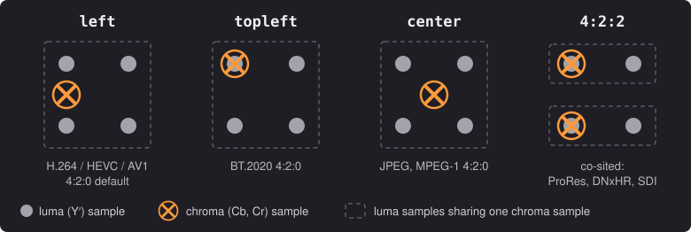
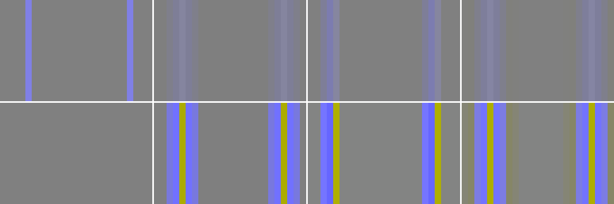
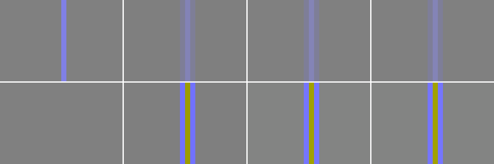
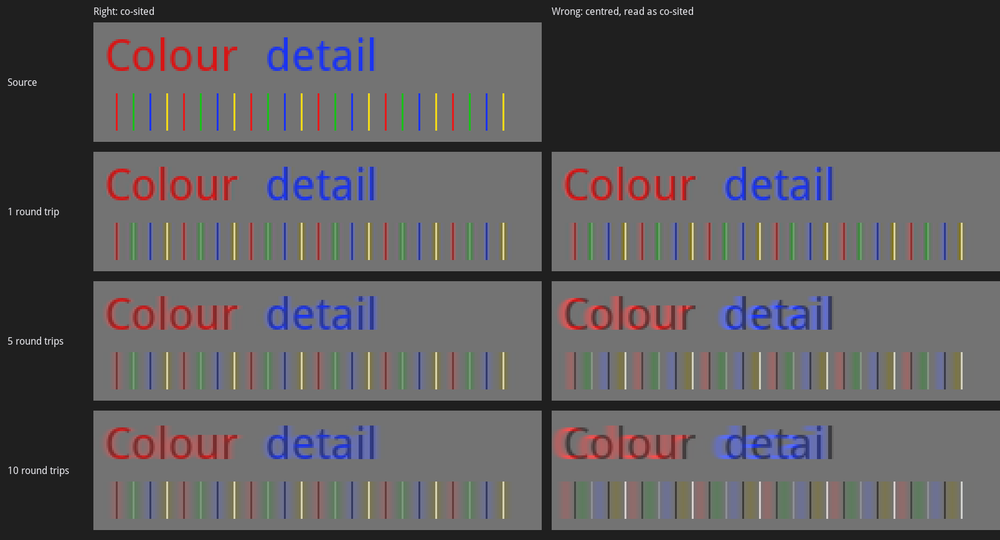
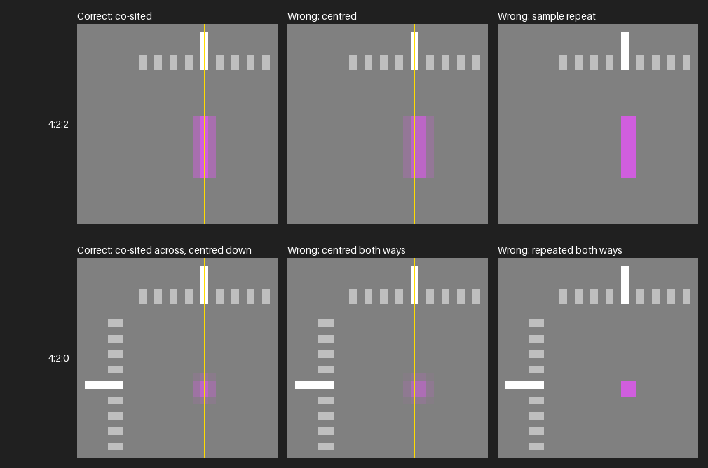

# Chroma Siting

<details open markdown="block">
  <summary>
    Table of contents
  </summary>
  {: .text-delta }
1. TOC
{:toc}
</details>

{: .highlight }
> **In short:** convert with `zscale` and leave its chroma location at the default. That co-sites the chroma
> horizontally (and centres it vertically for 4:2:0), which is what 4:2:2 and SDR H.264/HEVC/AV1 4:2:0 expect.
> `scale` (libswscale) centres it, half a pixel off, on every FFmpeg version we tested. For BT.2020/HDR 4:2:0 the
> choice is less clear; see the [Summary](#summary).

When an image is converted to 4:2:2 or 4:2:0, there is only one chroma (color) sample for every two luma samples
across, and for 4:2:0 also for every two down. *Chroma siting* (or chroma sample location) is where each of
those chroma samples **sits** relative to the luma samples:

* **Co-sited**: the chroma sample sits on top of the even luma sample. This is what professional 4:2:2
  (SDI, ProRes, DNxHD/DNxHR) and H.264, HEVC and AV1 4:2:0 expect horizontally.
* **Centered**: the chroma sample sits half way between two luma samples. This is the JPEG/MPEG-1 convention.

Vertically, H.264/HEVC 4:2:0 puts the chroma half way between two rows, so the usual target for 4:2:0 is co-sited
horizontally and centered vertically. BT.2020 instead defines its 4:2:0 as co-sited in both directions, and
specifications disagree about which to use for UHD and HDR, and even for HD; see
[What specifications ask for](#what-specifications-ask-for).

**In FFmpeg, and in tools that follow it** (`zscale`, VapourSynth, mpv and others), these positions have names,
which this page uses too:

| FFmpeg name | Horizontally | Vertically (4:2:0 only) | Typical of |
| :--- | :--- | :--- | :--- |
| `left` | co-sited | centered | H.264/HEVC/AV1 4:2:0 (the default), MPEG-2 4:2:0 |
| `topleft` | co-sited | co-sited | BT.2020 4:2:0 |
| `center` | centered | centered | JPEG, MPEG-1 |



So in FFmpeg, co-sited is usually called `left`. For 4:2:2, which has a chroma sample on every row, `left` and
`topleft` are the same position. The names are FFmpeg's: the standards describe the positions in words or numbers
instead (see [Where this is specified](ChromaSitingTests.html#where-this-is-specified)). And "left" only describes the horizontal
position; that it also means vertically centered is FFmpeg's convention, taken from MPEG-2 and H.264.

If the converter puts the chroma in one place and the player assumes another, the color is shifted half a pixel
against the detail. It is subtle, a fraction of a pixel on color edges, but it is systematic, and it accumulates
over round trips. For 4:2:2 the position is agreed (co-sited), so a file needs no label; it just has to be made
that way. For 4:2:0, H.264, HEVC and AV1 can say where the chroma is, but most players ignore what they say.

## Summary

* **`zscale` gets it right by default**, on every FFmpeg version we tested (6.0 to 9.1): co-sited
  horizontally, centered vertically for 4:2:0.
* **`scale` (libswscale), and the conversion FFmpeg inserts when there is no filter, center the chroma** on every
  version, including the new libswscale code (`flags=unstable`) and 9.1. 4:2:2 and
  H.264/HEVC/AV1 4:2:0 made this way are half a pixel off, and are read by players as co-sited.
* libswscale can be made to co-site, on 7.1 and later, with `out_chroma_loc=left` **and**
  `-sws_flags +full_chroma_inp`. Without `full_chroma_inp` it averages pairs of RGB pixels before filtering, and
  the result is only approximately co-sited.
* **4:2:2 needs no label**: every standard says co-sited, so the conversion just has to co-site it, and a player
  that centres it is simply wrong. ProRes, DNxHR and 4:2:2 H.264/HEVC have no field for it, and do not need one.
* **4:2:0 is where the choice is**, between `left` (the H.264/HEVC/AV1 default) and `topleft` (BT.2020). H.264,
  HEVC and AV1 have a field for it, but only some players read it. For SDR use `left`, which is the default and
  needs no label. For BT.2020/HDR the specifications mostly point to `topleft`, which must then be signalled, and
  players disagree (see [What specifications ask for](#what-specifications-ask-for)).
* **Reading 4:2:2 or 4:2:0 back to RGB has the same problem in reverse.** `zscale` reads the file's chroma
  location and assumes co-sited when there is none. libswscale, which is what a plain `ffmpeg -i movie.mov
  frame.png` uses, assumes centered whatever the file says, up to and including 9.0, so stills from ProRes, DNxHR
  or H.264 come out with the color half a pixel to the right. See [Reading back to RGB](#reading-back-to-rgb).
* **Players disagree too**, and a test chart shows which way each one goes when you look at it from a distance:
  of those we tried, only xStudio (with a fix) and Safari for HEVC/H.264 got 4:2:2 right throughout. For
  ordinary H.264/HEVC 4:2:0, Safari, Chrome and Firefox were right and OpenRV was not, and no player besides
  FFmpeg followed a chroma location tag reliably. See [Checking a player by eye](#checking-a-player).

Use `zscale` for the conversion, as in the recommended commands in [FFmpeg Version Changes](FFmpegChanges.html#recommended-commands)
and [FFmpeg zscale Filter](EncodeZscale.html), and leave its chroma location at the default. The measurements for each
converter are in [Results by converter](ChromaSitingTests.html#results-by-converter).

## What it looks like

The test chart has single-pixel blue lines on a gray background. Converted to 4:2:2 and decoded again the way a
player would (assuming co-sited chroma), zoomed in. In each image, the columns are: the source, `zscale`,
`scale`, and `scale` with `out_chroma_loc=left` and `full_chroma_inp`. The bottom row is the difference from the
source, amplified 8 times.

Lines on **odd** columns:



With `zscale` (second column) the color error is spread evenly either side of each line. With `scale` (third
column) it is all on the left: the line's color has moved half a pixel. The top row shows how subtle that is
at normal viewing; the difference row shows that it is there.

Lines on **even** columns look the same for all three, which is why this is easy to miss:



### Over repeated round trips {#round-trips}

The error is small once, but it adds up: material is often converted to Y'CbCr and back several times, for example
rendered, reviewed, graded and delivered. Here a small image goes through 1, 5 and 10 round trips of RGB to 4:2:2
10-bit and back, all with `zscale`, so the siting is the only difference. On the left the encoder writes co-sited
chroma and the player assumes co-sited. On the right the encoder writes centered chroma, as libswscale does, and the
player still assumes co-sited, as players do for 4:2:2:



| Round trips | Color moved left, right siting | Color moved left, wrong siting |
| :--- | ---: | ---: |
| 1 | 0.04 px | 0.54 px |
| 5 | 0.03 px | 2.51 px |
| 10 | 0.02 px | 4.00 px |

Some softening is unavoidable with 4:2:2 either way: every round trip loses a little color detail. With the wrong
siting the color also moves about half a pixel to the left each time, and after a few round trips it is visibly
off the detail. A smooth gradient, by contrast, hardly changes, because shifting it by half a pixel changes almost
nothing. Siting errors show on sharp color edges, fine colored lines and colored text. Made with
`tests/chroma_siting_generations.py`; the results were identical on FFmpeg 6.1.6, 9.0.2 and 9.1 (zoomed 3 times with nearest neighbor).

## Where chroma siting is recorded

Where the chroma is can be recorded in these places ([each codec and container](ChromaSitingTests.html#recorded-details)):

* **H.264, HEVC and AV1** have a field, for 4:2:0 only.
* **ProRes and DNxHD/DNxHR** have none, and MOV and MP4 add nothing to what the codec stream carries.
* **Matroska and WebM** record it for every codec, and FFmpeg reads it back.
* **MXF** records it, but FFmpeg does not read it back.

Two things follow:

* For ProRes and DNxHR in MOV, and for any 4:2:2 H.264 or HEVC, there is no field, and none is needed: 4:2:2 is
  co-sited by every standard and read that way, so it has to be made co-sited.
* `ffprobe`'s `chroma_location` is not always what is in the file. For H.264 it shows `left` when nothing is
  written, even for 4:2:2, and for AV1 in MP4 it showed `unspecified` even when the stream had `left`.

**For 4:2:2 MXF, leave `zscale`'s chroma location at its default** (or use `topleft`), which gives the correct
`ColorSiting` of 0; do not set it to `left`. DNxHR in MXF made with `scale` is labelled co-sited while its chroma is
centered, so the file states the wrong thing; see [DNxHR in MXF](ChromaSitingTests.html#dnxhr-in-mxf).

## What specifications ask for {#what-specifications-ask-for}

For 4:2:2 there is no disagreement: it is co-sited, and in ProRes, DNxHR and 4:2:2 H.264/HEVC there is nowhere to
say otherwise. For 4:2:0 the choice is between `left` (H.264/HEVC VUI type 0, co-sited horizontally and centered
vertically) and `topleft` (type 2, co-sited both ways). Most of the specifications that choose are written for a
particular kind of device, and they do not agree:

| Specification | Applies to | 4:2:0 siting |
| :--- | :--- | :--- |
| ITU-T H.264 / H.265, Annex E | Every H.264/HEVC decoder | `left` (0) when nothing is signalled. H.265 has recommended `topleft` (2) for BT.2020 and BT.2100 video since its 2018 edition, according to [Dolby](https://ott.dolby.com/OnDelKits/Dolby_Vision_Online_Delivery_Kit/v1/Documentation/Specs/Visio_Profiles/help_files/topics/c_dovi_profiles_public.html) and 3GPP (we have not checked the ITU text) |
| [ITU-T H.Sup19](https://www.itu.int/epublications/publication/itu-t-h-suppl-19-2021-04-usage-of-video-signal-type-code-points) / ISO/IEC TR 23091-4, typical values | Guidance, summarizing the delivery specifications | `left` (0) for SD and HD, `topleft` (2) for UHD with wide color gamut |
| [DVB, ETSI TS 101 154](https://www.etsi.org/deliver/etsi_ts/101100_101199/101154/02.09.01_60/ts_101154v020901p.pdf) V2.9.1, clause 5.14.1.5.3 (HEVC) | Broadcast receivers and set-top boxes in Europe and most of the world outside the Americas, Japan and Korea | The siting **shall** be signalled; recommends `left` (0) for progressive BT.709 and `topleft` (2) for progressive BT.2020. (For H.264 it recommends 0.) |
| [ATSC 3.0, A/341:2024](https://www.atsc.org/wp-content/uploads/2024/04/A341-2024-04-Video-HEVC.pdf), section 6.2.3.2 | Broadcast receivers ("NextGen TV") in the US and Korea | **`topleft` (2), required for all progressive video**, including 1080p and 720p BT.709 SDR. `left` (0) for legacy SD and interlaced HD ([Amendment 1](https://www.atsc.org/wp-content/uploads/2022/09/A341-2022-03-Amendment-No-1.pdf), 2022) |
| Blu-ray Disc (BD-ROM Part 3) | HD Blu-ray (H.264, VC-1, MPEG-2) and Ultra HD Blu-ray (HEVC) players | The specifications are not public. H.Sup19 cites BD-ROM Part 3 v3.2 for `topleft` (2) in UHD wide color gamut, and Dolby's profile 7 (the Ultra HD Blu-ray profile) defaults to `topleft`. [Encoder users report](https://forum.doom9.org/archive/index.php/t-175042.html) that a BT.2020 disc must signal 2 and a BT.709 one may use 0 or 2. For HD Blu-ray we have found nothing beyond the H.264/MPEG-2 default, `left` |
| [Dolby Vision profiles](https://ott.dolby.com/OnDelKits/Dolby_Vision_Online_Delivery_Kit/v1/Documentation/Specs/Visio_Profiles/help_files/topics/c_dovi_profiles_public.html) | Dolby Vision devices: profile 5 and 8.1 for streaming, 7 for Ultra HD Blu-ray, 8.4 for HLG | Either, but the VUI must say so unless it is `left`. Default `left` (0) for profile 5 ("all commercially produced profile 5 ... bitstreams have used center-left siting"), for the HDR10 base layer of profile 8.1 and for the DVB HLG base layer of 8.4; `topleft` (2) for profile 7 and for the ARIB (Japanese broadcast) HLG base layer of 8.4 |
| [Apple HLS authoring specification](https://developer.apple.com/documentation/http-live-streaming/hls-authoring-specification-for-apple-devices) | Streaming to Apple devices | Says nothing about siting, so `left`, the H.264/HEVC default |

Where they disagree:

* **HD:** a 1080p BT.709 HEVC stream for ATSC 3.0 must be `topleft`; the same stream for DVB is recommended to be
  `left`, which is also what H.264/HEVC readers assume when nothing is signalled.
* **HDR10 and HLG:** H.265, DVB, ATSC and Ultra HD Blu-ray point to `topleft` for BT.2020/BT.2100, but most
  streaming HDR (Dolby Vision profile 5, and the HDR10 base layer of profile 8.1) is `left`, and Dolby's own
  default for a DVB HLG base layer is `left` where DVB recommends `topleft`.
* **Players:** Dolby notes that `topleft` is checked when a Dolby Vision chip is approved, but not when a device
  is. A player that ignores the VUI treats `topleft` material as `left`, and puts the chroma half a line too
  low, as Firefox does. The reverse also happens: on a Mac, Safari 26.6, Chrome 157 and QuickTime Player showed
  HDR10 HEVC tagged `topleft` exactly right, but untagged or `left` HDR10 neither centered nor co-sited down, though
  the same SDR files were right ([measured](ChromaSitingTests.html#chart-420-hdr10)). So on a Mac no choice is
  right in every player. To check a player or TV, there are HDR10 copies of the
  4:2:0 chart with and without the `topleft` tag.

So for anything that is not going to a broadcaster or onto a disc with its own specification (review files, web
and streaming, files played on desktops and phones), use `left`, the `zscale` default. Use `topleft` when the
delivery specification asks for it: ATSC 3.0, Ultra HD Blu-ray, and BT.2020 HEVC for DVB.

### Should the siting always be signalled? {#signalling}

Signalling it is safe, but it is not enough on its own:

* **Most players ignore the tag** (see [Checking a player by eye](#checking-a-player)): of those we tried, only
  FFmpeg followed it reliably. So the pixels have to be where players assume, `left`, unless a specification says
  otherwise. A `topleft` file is shown correctly only by a player that reads the tag.
* **Signalling `left` costs nothing**, and DVB requires the siting to be signalled for HEVC. It is not needed
  elsewhere, since `left` is what H.264/HEVC readers assume when nothing is written.
* **Signalling `topleft` is essential**: without it every reader assumes `left`.
* **It can only be signalled for 4:2:0 H.264, HEVC and AV1, and in Matroska.** For ProRes, DNxHR and any 4:2:2 in
  MOV or MP4 there is nothing to set; co-siting the chroma is all you can do (see
  [Where chroma siting is recorded](#where-chroma-siting-is-recorded)).

A label that disagrees with the pixels is worse than no label, so **set the siting on the conversion**, with
`zscale`'s `chromal`. That puts the chroma there and labels the frames, and the encoder writes the label (for
BT.2020, use the matching `matrix` and primaries as well):

```console
ffmpeg -i input.%04d.png -vf "zscale=matrix=709:range=limited:chromal=left:filter=lanczos,format=yuv420p10le,setparams=color_primaries=bt709:color_trc=iec61966-2-1" -c:v libx265 -crf 18 -colorspace bt709 output.mp4
```

What we measured, with `libx265` and `libx264` 4:2:0 on FFmpeg 6.1.6, 7.1.5, 8.1, 9.0.2 and 9.1:

| Command | Pixels | What is written |
| :--- | :--- | :--- |
| `zscale` with no `chromal` | `left` | Nothing (the frames carry no location), which readers take as `left` |
| `zscale=...:chromal=left` | `left` | `libx265`: type 0. `libx264`: nothing, because x264 never writes type 0, even with `-x264-params chromaloc=0` |
| `zscale=...:chromal=topleft` | `topleft` (measured 0.00 px horizontally, 0.02 vertically) | Type 2 with both encoders |
| `scale` | Centered | Nothing, so it is read as `left`: half a pixel off |

The options that only set the label do not move the chroma, so with `scale`, or with `zscale` at its default and
a `topleft` label, they give a file whose label is wrong:

* **`-chroma_sample_location`** relabelled the frames without converting on 6.1.6, 8.1 and 9.0.2, was ignored on
  7.1.5, and from 9.1 makes `zscale` convert to it. Do not rely on it.
* **`setparams=chroma_location=`** (FFmpeg 7.1 and later) only relabels.
* **`-x265-params chromaloc=`** overrides what `libx265` writes, whatever the pixels are.

FFmpeg's wrappers for `libx264`, `libx265`, `libsvtav1` and the VAAPI/Vulkan H.264 encoders pass the location on;
`libaom-av1` writes unknown ([measured](ChromaSitingTests.html#recorded-details)), and the VideoToolbox and NVENC
wrappers have no code to pass it on (from the FFmpeg source; not measured).

To check what a file says, read the bitstream; `ffprobe`'s `chroma_location` shows a default when nothing is
written:

```console
ffmpeg -i output.mp4 -c copy -bsf:v trace_headers -f null - 2>&1 | grep -E "chroma_loc_info_present_flag|chroma_sample_loc_type|chroma_sample_position"
```

For H.264/HEVC, `chroma_loc_info_present_flag` 0 (or no line) means nothing is written; 1 is followed by the
type. For AV1, `chroma_sample_position` is 0 (unknown), 1 (`left`) or 2 (`topleft`). In 4:2:2 MXF, `topleft` is
also the value that gives the correct `ColorSiting` (see [DNxHR in MXF](ChromaSitingTests.html#dnxhr-in-mxf)).

## Reading back to RGB {#reading-back-to-rgb}

When FFmpeg converts 4:2:2 or 4:2:0 to RGB, for example to make review stills from a ProRes or H.264 file, it has
to decide where the chroma samples are before it can interpolate them. `zscale` reads the file's chroma location and
assumes co-sited when there is none, which is correct. libswscale (`scale`, or no filter) assumes centered whatever
the file says, on every release up to 9.0 (tested from 6.1). From 9.1 it follows the tag if there is one, and
still assumes centered if there is not ([measurements](ChromaSitingTests.html#reading-back-results)).

So a co-sited file, which is every ProRes, DNxHR and 4:2:2 H.264/HEVC file and most H.264/HEVC 4:2:0, converted
to RGB without a filter comes out half a pixel off on every version. From 9.1 that is fixed only
for files that carry a chroma location, which in MOV and MP4 is only 4:2:0 H.264/HEVC with a non-default
location (see [Where chroma siting is recorded](#where-chroma-siting-is-recorded)). Use `zscale`:

```console
ffmpeg -i input.mov -frames:v 1 -vf "zscale,format=gbrp16le" -pix_fmt rgb48be frame.png
```

`format=gbrp16le` keeps the conversion in `zscale` (it outputs planar RGB; the repack to `rgb48be` for PNG is
lossless). `zscale` needs the file's matrix to be tagged; for an untagged file give it with
`zscale=matrixin=709:rangein=limited`. The matrix and range accuracy of the conversion, and what happens with
untagged files, are covered in [FFmpeg Version Changes](FFmpegChanges.html#ycbcr-to-rgb).

## Checking a player by eye {#checking-a-player}

Most players and browsers cannot be measured from a script, so there are test charts you can look at instead. They are
in `sourceimages/`. How they work, and the results in detail, are on the separate [Chroma Siting Tests](ChromaSitingTests.html) page.

### Quick guide: what should I see? {#quick-guide}

There are two kinds of chart. The **player charts** are full HD: you look at them from a distance, and a whole band
changes appearance. The **pixel charts** are 64x64: you zoom in and look at single pixels. Start with a player chart;
use a pixel chart to confirm the result or to show someone exactly what is wrong.

| Chart | Open | Correct | Not correct |
| :--- | :--- | :--- | :--- |
| 4:2:2 player chart | `chroma_siting_player_chart_422-prores.mov` or `-hevc.mp4` | Only the top band, "Co-sited", is a flat field. The other three are still checkerboards | A different band is flat: the player assumes that instead. None flat: it is doing something else. The top band changes part way across: part of the picture is wrong (xStudio 1.4.0) |
| 4:2:0 player chart | `chroma_siting_player_chart_420-h264.mp4` or `-hevc.mp4` | Two bands are flat: "Across: co-sited" and "Down: centered". The other two are checkerboards | "Across: centered" is flat instead of "Across: co-sited": the color is half a pixel to the right (OpenRV, xStudio 8-bit). "Down: co-sited" is flat instead of "Down: centered": the player assumes `topleft` |
| 4:2:2 pixel chart | `chroma_siting_pixel_chart_422-10bit.mkv` | One strong column of color directly under each long tick, with a fainter column either side | The color is off to the right of the tick: two strong columns starting at the tick (centered, or sample repeat) |
| 4:2:0 pixel chart | `chroma_siting_pixel_chart_420-10bit.mkv` | Across, as for 4:2:2. Down, two equally strong rows: the row of the long tick on the left and the row below it | The color is off to the right of the top ruler's tick. Centered on the left ruler's tick row: the player assumes `topleft` |

The same pattern is correct for all the H.264, HEVC and AV1 files with no chroma location tag. The tagged 4:2:0 files
change the answer on purpose: `-topleft` should make "Across: co-sited" and "Down: co-sited" flat, and `-center` should
make "Across: centered" and "Down: centered" flat, if the player reads the tag ([details](ChromaSitingTests.html#chart-420)).

Three things catch people out:

* **Player charts only work at exactly 100%**, viewed from a distance. Their scale check patch, top right, should have
  two halves equally bright from a distance. If not, ignore the bands.
* **The color of a flat band means nothing.** Each band has its own colors; only whether it is flat matters.
* **Pixel charts work at any zoom**, but in OpenRV stay on the default Linear filter. Flip against the matching
  `-reference.mkv` in the same player to compare, and judge where the color is centered, not how blocky it looks.

Zoomed in on one cell of a pixel chart, with lines through the long ticks. In 4:2:0 the correct color is centered on
the vertical line and straddles the row below the horizontal line:



A wrong result means fine color detail sits half a pixel to the right of the luma, or is softer than it should be.
It is the player, not the file: these charts decode exactly in `zscale`.

### What we found

Measured on macOS 26 (Apple M2), at one image pixel per screen pixel. The [test page](ChromaSitingTests.html) has the
results per codec and FFmpeg version, and how the charts work.

| Player or conversion | 4:2:2,<br>should be co-sited ([BT.709 item 4.3](https://www.itu.int/rec/R-REC-BT.709)) | Ordinary H.264/HEVC 4:2:0,<br>should be `left`: co-sited across, centered down ([H.264](https://www.itu.int/rec/T-REC-H.264)/[H.265](https://www.itu.int/rec/T-REC-H.265) Annex E default) | Reads the chroma location tag? |
| :--- | :--- | :--- | :--- |
| `zscale` | Correct | Correct | Yes |
| libswscale, up to 9.0 | **Centered, or sample repeat** | **Centered both ways** | No |
| Safari 26.6.2 | Correct for HEVC and H.264; **ProRes wrong** | Correct; **HDR10: down neither centered nor co-sited** | HEVC `topleft` and `center`, H.264 `center` (8- and 10-bit), HDR10 HEVC `topleft`: yes. **H.264 `topleft` (8- and 10-bit): no**, shown centered both ways |
| Chrome 156 and 157 | Correct for HEVC; **H.264 centered** | Correct, except **10-bit H.264 centered across**; **HDR10: down neither centered nor co-sited** | HEVC `topleft` and `center`, 8-bit H.264 `center`, HDR10 HEVC `topleft`: yes. **H.264 `topleft` (8- and 10-bit): no**, shown centered both ways |
| Firefox 152 (HDR10: 159) | **HEVC wrong**: chroma also lost vertically | Correct, including HDR10 | No |
| OpenRV 3.1.0 | **Centered** | **Centered both ways** | No |
| xStudio, with the [4:2:2 fix](https://github.com/AcademySoftwareFoundation/xstudio/pull/361) (not yet merged) | 10-bit correct; **8-bit sample repeat** | 10-bit correct; **8-bit centered across** | No |

xStudio 1.4.0 has the same results as the fixed build, except that in 10-bit only the left half of the picture is
interpolated.

QuickTime Player 10.5 (4:2:0 only, HEVC) behaves like Safari: correct, follows `topleft`, and for HDR10 is neither
centered nor co-sited down unless the file is tagged `topleft`.
