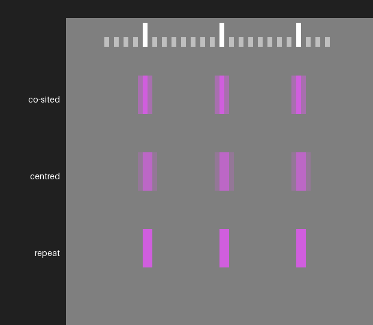
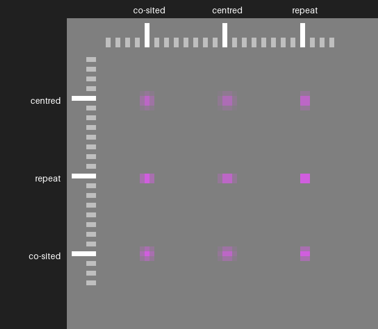
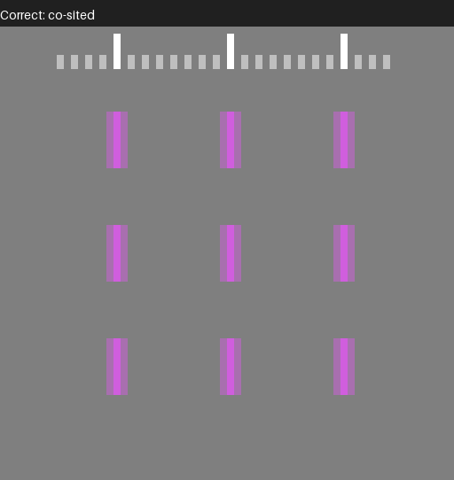
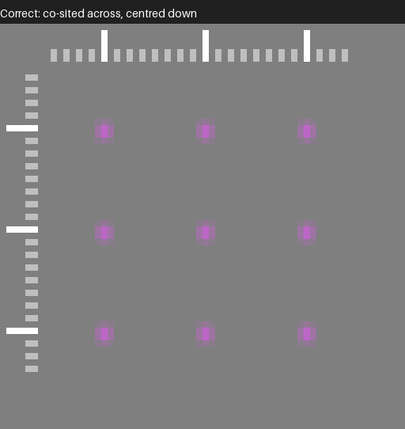

# Chroma Siting Pixel Charts: Showing It Pixel by Pixel

  

    Table of contents
  

  {: .text-delta }
1. TOC
{:toc}

The [Chroma Siting Check](sourceimages/chroma_siting_check/README.html) files and the
[4:2:2 player chart](ChromaSitingPlayerChart.html) depend on the display and the eye. To check their answer
directly, or to show someone exactly what a player gets wrong, these 64x64 charts are made to be zoomed in on. The
luma is flat gray and single chroma samples are raised, so the only thing that can spread the color is the player's
chroma reconstruction.

## The files

Lossless FFV1 in Matroska, so they are for desktop players, not browsers:
[_422-10bit.mkv](sourceimages/chroma_siting_pixel_chart_422-10bit.mkv),
[_422-8bit.mkv](sourceimages/chroma_siting_pixel_chart_422-8bit.mkv),
[_420-10bit.mkv](sourceimages/chroma_siting_pixel_chart_420-10bit.mkv),
[_420-8bit.mkv](sourceimages/chroma_siting_pixel_chart_420-8bit.mkv), and the 4:4:4 references
[_422-reference.mkv](sourceimages/chroma_siting_pixel_chart_422-reference.mkv) and
[_420-reference.mkv](sourceimages/chroma_siting_pixel_chart_420-reference.mkv) (every name starts with
`chroma_siting_pixel_chart`). They are made by [make_chroma_siting_pixel_chart.py](sourceimages/make_chroma_siting_pixel_chart.py)
and measured by `tests/chroma_siting_pixel_chart.py`.

## Reading them

| The player assumes | Weight of the sample in the columns tick-1, tick, tick+1, tick+2 | The color is centered |
| :--- | :--- | :--- |
| Co-sited, interpolated | .5, 1, .5, 0 | **on the tick** |
| Centered, linear | .25, .75, .75, .25 | between the tick and the next column |
| Sample repeat | 0, 1, 1, 0 | between the tick and the next column |

The long ticks in the luma rulers mark the column (and, in 4:2:0, the row) of the raised sample; the short ones mark
every chroma site. There are three cells across, so a fault in only part of the picture shows. For 4:2:0 the same
reading applies down the picture against the left ruler, where the `left` default is centered *between* the tick
and the next row.

Open the test file and its reference in the same player and flip between them at the same zoom. The reference is
4:4:4, so the player has no chroma to reconstruct, and it goes through the same view transform. Most of each
reference shows what wrong players do; only the top row (4:2:2) or top-left square (4:2:0) is correct for H.264,
HEVC, ProRes and DNxHD/DNxHR:

| 4:2:2 reference: one assumption per row | 4:2:0 reference: across by column, down by row |
| :--- | :--- |
|  |  |

A correct player makes every cell of the test file look like this:

| 4:2:2: what a correct player shows | 4:2:0: what a correct player shows |
| :--- | :--- |
|  |  |

These are the exact pixels, enlarged without smoothing. They match the test files decoded with `zscale` to within
about 1 code value in 10 bits (FFmpeg 6.1.6, 7.1.5, 8.1, 9.0.2 and 9.1).

How a player zooms matters:

* **xStudio** computes each image pixel in its shader, so any zoom shows the real values. Trust the screen, not the
  pixel probe, which is separate code.
* **OpenRV** applies its filter setting (`n` toggles it) to the chroma planes as well as the luma. Under Linear, the
  default, a zoomed view is smooth, but the peak of the color is where the chroma is. Under Nearest the chroma
  becomes sample repeat across, which is not what RV shows at normal playback. Check the chroma position, not the
  pixel shapes, or use Linear.

## Results

Players measured on macOS 26 (Apple M2) from window screenshots, sampled at the center of each image pixel, with
`tests/chroma_siting_pixel_chart.py --capture`. FFmpeg measured on 6.1.6, 7.1.5, 8.1, 9.0.2 and 9.1; the same on all
of them except where a row says so:

| Player or conversion | 4:2:2 10-bit | 4:2:2 8-bit | 4:2:0 10-bit | 4:2:0 8-bit |
| :--- | :--- | :--- | :--- | :--- |
| `zscale` | Co-sited | Co-sited | Co-sited across, centered down | Co-sited across, centered down |
| No filter, to planar RGB, up to 9.0.2 | **Centered** | **Centered** | **Centered both ways** | **Centered both ways** |
| No filter, to planar RGB, 9.1 (the files are tagged `left`) | Co-sited | Co-sited | Co-sited across, centered down | Co-sited across, centered down |
| No filter, to packed RGB | **Sample repeat** (9.1: see below) | **Sample repeat** | **Repeat across**, centered down | **Repeat both ways** |
| OpenRV 3.1.0 (Linear) | **Centered** | **Centered** | **Centered both ways** | **Centered both ways** |
| xStudio, with the 4:2:2 fix | Co-sited | **Sample repeat** | Co-sited across, repeat down | **Repeat both ways** |

Where a larger chart covers the same case the two agree (8-bit 4:2:2 is only measured here). 10-bit to packed RGB on
9.1 is the exception: sample repeat is the nearest of the patterns this chart models, but a poor match, and the
4:2:2 player chart reads that conversion as centered bicubic. "Repeat down" puts the 4:2:0 chroma in the right place
for H.264 and HEVC (centered between the rows) but without interpolating it.
