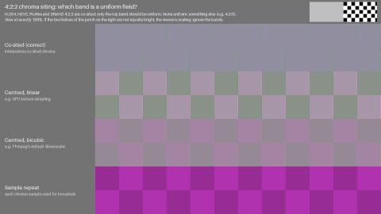
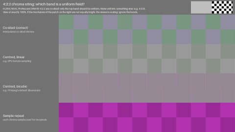
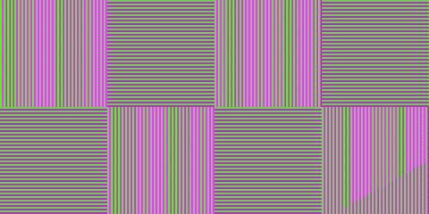

# Chroma Siting 4:2:2 Player Chart: How Is the Player Wrong?

  

    Table of contents
  

  {: .text-delta }
1. TOC
{:toc}

The [Chroma Siting Check](sourceimages/chroma_siting_check/README.html) files say whether a player follows the label.
This chart says what a 4:2:2 player does instead: it tells a centered linear filter (GPU texture sampling) from a
centered bicubic one (libswscale) and from repeating each sample (writing a PNG), which is what you need to file a
bug or fix a player.

## The files

[chroma_siting_player_chart_422-prores.mov](sourceimages/chroma_siting_player_chart_422-prores.mov) (ProRes 422 HQ),
[-hevc.mp4](sourceimages/chroma_siting_player_chart_422-hevc.mp4) (HEVC 4:2:2 10-bit, which browsers play),
[-h264.mp4](sourceimages/chroma_siting_player_chart_422-h264.mp4) (lossless H.264 4:2:2 10-bit) and
[-dnxhr.mxf](https://github.com/AcademySoftwareFoundation/EncodingGuidelines/raw/main/sourceimages/chroma_siting_player_chart_422-dnxhr.mxf)
(DNxHR HQX), with a lossless FFV1 copy in
[-lossless.mkv](sourceimages/chroma_siting_player_chart_422-lossless.mkv), all 1920x1080. They are made by
[make_chroma_siting_player_chart.py](sourceimages/make_chroma_siting_player_chart.py) and measured by
`tests/chroma_siting_player_chart.py` (on its own it decodes the FFV1 copy with FFmpeg; with `--capture` it reads a
screenshot). The chroma in every file is co-sited, and `zscale` decodes all of them exactly, so a wrong band is the
player, not the file. Do not re-encode them: compression blurs the one-pixel stripes.

## Reading the chart

1. **Show it at exactly 100%**: one image pixel per screen pixel ("1:1" in RV and xStudio, not "fit"; in a
   browser, page zoom 100% and a window wide enough for the whole frame). From a distance, the two halves of the
   patch at the top right should look equally bright. If the fine half looks darker, the player is scaling the
   picture, and the bands mean nothing.
2. **Step back.** Each band is a checkerboard of striped blocks. The band that turns into a uniform field says how
   the player rebuilds the chroma. For a correct player that is the top one: H.264, HEVC, ProRes and DNxHD/DNxHR
   4:2:2 are all co-sited.

| Band | Uniform when the player | Typical of |
| :--- | :--- | :--- |
| Co-sited (correct) | treats the chroma as co-sited and interpolates it | `zscale`; xStudio with its 4:2:2 fix |
| Centered, linear | treats it as centered, linear interpolation | GPU texture sampling (RV); libswscale `bilinear` |
| Centered, bicubic | treats it as centered, bicubic or lanczos | libswscale to planar RGB, or with `full_chroma_int` |
| Sample repeat | uses each chroma sample for two pixels | libswscale to packed RGB (e.g. writing a PNG), up to 9.0 |

If no band is uniform, the player is doing something else, for example converting to 4:2:0 or using the nearest
chroma sample. From a distance (simulated by averaging in linear light), decoded by `zscale` and by libswscale to
planar RGB on 9.0:

| `zscale`: top band uniform | libswscale, centered bicubic: third band uniform |
| :--- | :--- |
|  |  |

These are pictures of the result, already converted to RGB, so they look the same in any viewer. The test is the
video files.

## How it works

The test blocks have vertical stripes in a four-pixel cycle, with the two chroma samples on the even (co-sited)
columns. 4:2:2 keeps those and drops the odd columns, so the player has to rebuild the odd columns' chroma, and how
it does that depends on where it thinks the samples are. The reference blocks have the same stripes turned through
90 degrees, which 4:2:2 holds exactly. Each band's reference stripes are the pixels one kind of player makes from
its test stripes, so in the band that matches the player, test and reference blocks contain exactly the same
pixels, whatever the display or view transform does to them.

The difference only appears when the display turns each pixel into light and the eye averages it. A viewer that
shrinks the picture averages code values first, which removes it, hence the scale check. The colors were chosen so
that each wrong band differs from the right one by at least 0.04 in Oklab (linear light), with every pixel in gamut.
The chart tests the finest chroma detail 4:2:2 can hold, so a player can place coarse color correctly and still
fail here, as FFmpeg 9.1 does decoding to packed RGB.

## Results

Measured on macOS 26 (Apple M2), from window screenshots at 1:1 (`screencapture -o -l`):

| Player | ProRes 422 HQ | HEVC 4:2:2 | H.264 4:2:2 |
| :--- | :--- | :--- | :--- |
| Safari 26.6.2 | **None uniform**: nearest sample | Co-sited (correct) | Co-sited (correct) |
| Chrome 156 | Does not play | Co-sited (correct) | **Centered, linear** |
| Firefox 152 | Does not play | **None uniform**: vertical chroma also lost, as in 4:2:0 | Does not play |
| OpenRV 3.1.0 | **Centered, linear** | **Centered, linear** | **Centered, linear** |
| xStudio 1.4.0 | **Left half co-sited, right half sample repeat** | the same | the same |

* **Chrome** may decode 10-bit 4:2:2 H.264 in software and convert it itself, while macOS handles HEVC (not
  confirmed).
* **Safari's ProRes** takes each odd column's chroma from the nearest sample, but every odd column is exactly
  halfway between two, so rounding decides which. It shows as vertical stripes, and a diagonal seam where the two
  triangles that draw the frame meet. Over an area this is close to right, but every odd pixel is wrong.

  
* **OpenRV** stores the file's chroma placement but samples the half-width chroma texture with linear filtering,
  which is centered.
* **xStudio** 1.4.0 stops interpolating half way across the picture; a
  [fix](https://github.com/AcademySoftwareFoundation/xstudio/pull/361) is waiting to be merged. Its 8-bit path
  always repeats each sample.

FFmpeg, on the FFV1 copy:

| Conversion | 6.1.6 and 9.0.2 | 9.1 |
| :--- | :--- | :--- |
| `zscale` | Co-sited | Co-sited |
| No filter, to packed RGB (PNG, `rgb24`, `rgb48`) | **Sample repeat** | **Centered, bicubic** (finest detail only) |
| No filter, to planar RGB (`gbrp16le`) | **Centered, bicubic** | Co-sited (the file is tagged `left`) |
| `scale=flags=...+full_chroma_int` | **Centered** (linear or bicubic, as the flag) | Co-sited |

## Does the player read the label? {#reading-the-label}

MOV and MP4 have nowhere to record 4:2:2 siting, so with those a player can only use its own assumption. Matroska
and MXF can record it, so there is a second copy of each with the same co-sited pixels and a label that says
centered:

* [-lossless.mkv](sourceimages/chroma_siting_player_chart_422-lossless.mkv) is labelled `left` (co-sited);
  [-labelled-center.mkv](sourceimages/chroma_siting_player_chart_422-labelled-center.mkv) is labelled `center`.
* [-dnxhr.mxf](https://github.com/AcademySoftwareFoundation/EncodingGuidelines/raw/main/sourceimages/chroma_siting_player_chart_422-dnxhr.mxf)
  has `ColorSiting` 0 (co-sited);
  [-dnxhr-labelled-center.mxf](https://github.com/AcademySoftwareFoundation/EncodingGuidelines/raw/main/sourceimages/chroma_siting_player_chart_422-dnxhr-labelled-center.mxf)
  has `ColorSiting` 1 (ST 377-1's value for centered 4:2:2, which FFmpeg cannot write, so the generator patches it).

A player that ignores the label shows the same band for both files of a pair; one that reads it shows a centered
band for the mislabelled file.

| Player | MKV `left` / `center` | MXF `ColorSiting` 0 / 1 |
| :--- | :--- | :--- |
| FFmpeg `zscale` (9.0.2, 9.1) | Co-sited / centered linear: **reads it** | Co-sited / co-sited: does not read it |
| FFmpeg, no filter, to planar RGB, 9.0.2 | Centered bicubic / centered bicubic: ignores it | Centered bicubic / centered bicubic |
| FFmpeg, no filter, to planar RGB, 9.1 | Co-sited / centered bicubic: **reads it** | Centered bicubic / centered bicubic: no label, so assumes centered |
| OpenRV 3.1.0 | Centered linear / centered linear: ignores it | Centered linear / centered linear: ignores it |

FFmpeg does not read MXF's `ColorSiting` at all, so neither does anything built on it.

What a browser draws into a `<canvas>` (`drawImage`) is not what it shows on screen: Safari's canvas was correct for
ProRes and Chrome's was wrong for HEVC, the reverse of the screen. So a page that reads the video back cannot
measure a browser; use screenshots, or your eyes.
