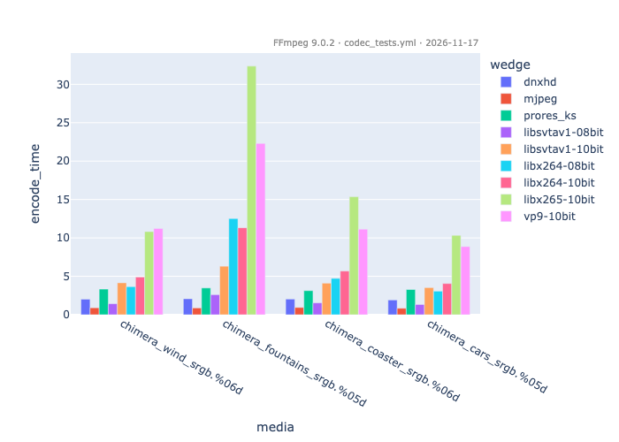
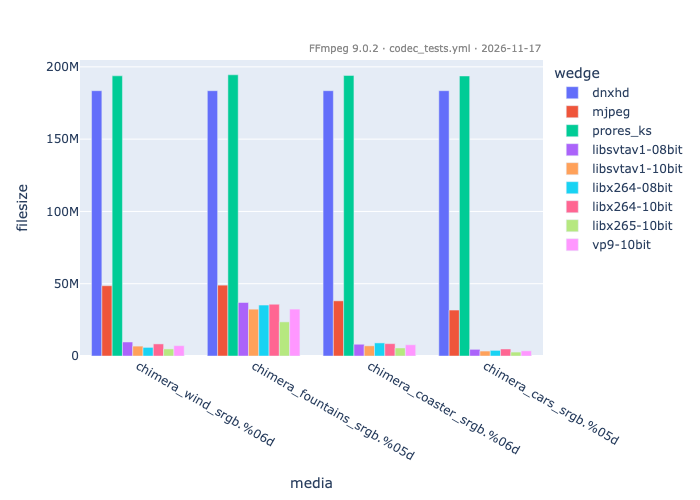
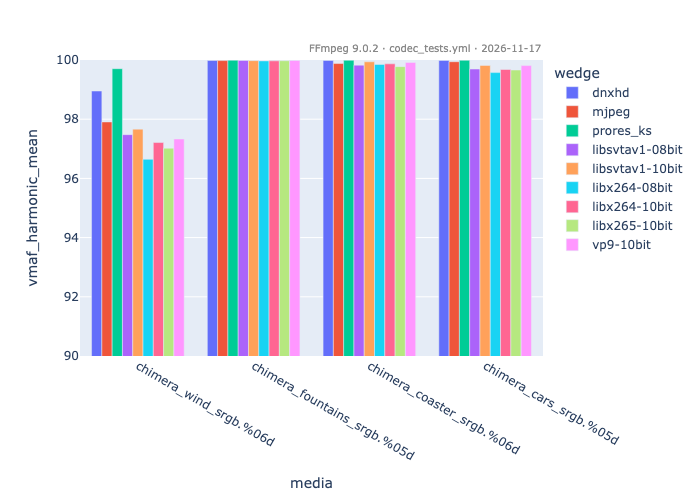
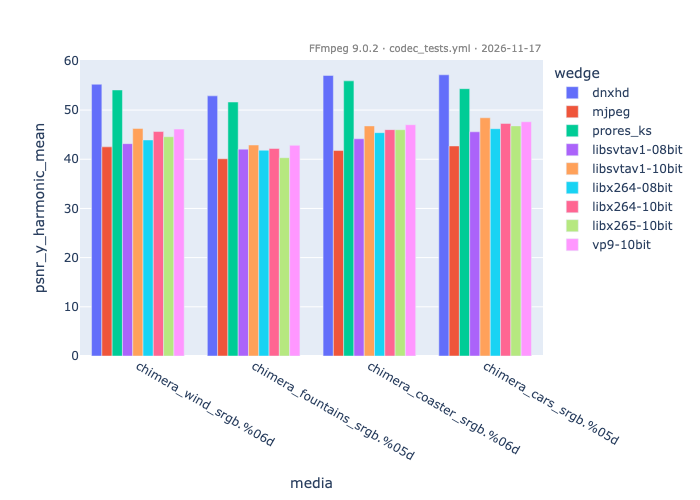

# Codec Comparisons

  

    Table of contents
  

  {: .text-delta }
1. TOC
{:toc}

FFmpeg supports over 100 video codecs, but only a fraction of those are really worth a deeper dive.

We are going to focus on codecs that match one of the following conditions:

* Supported by common web browsers.
* Have good compression ratios with good color fidelity.
* Supported by common apps, e.g. Resolve, RV, AVID.
* Commonly requested as a delivery format by studios or clients.

## Which codec for which job

| Job | Codec | Notes |
| :--- | :--- | :--- |
| Web and browser review | [H.264](Encodeh264.html), or [AV1](EncodeAv1.html) / [VP9](EncodeVP9.html) where supported | 4:2:0. H.264 plays almost everywhere; see the [Encoding Cheatsheet](Quickstart.html#h264-encoding-from-an-image-sequence-for-web-review). |
| Desktop review (RV, OpenRV) | [H.264](Encodeh264.html) 4:4:4 10-bit, or [ProRes](EncodeProres.html) | 4:4:4 avoids chroma subsampling. |
| Editorial (Avid) | [DNxHD/DNxHR](EncodeDNXHD.html) | In MXF or MOV; see also [Adding Timecode and Editorial Workflow](EditorialWorkflow.html). |
| Client delivery, Resolve, Mac | [ProRes](EncodeProres.html) 422 HQ | ProRes 4444 for 4:4:4 or alpha. |
| Intra-frame, open standard | [OpenAPV](EncodeOpenAPV.html), [HTJ2K](EncodeHTJ2K.html) | Newer, with less player support. |
| Avoiding the Y'CbCr conversion | See [RGB Encoding](RGBEncoding.html) | HEVC, VP9, DNxHR 444 and others can store RGB. |
| HDR | See [HDR Encoding](enctests/HDR_Encoding.html) | |

Whichever codec you pick, we recommend converting RGB to Y'CbCr with [`zscale`](EncodeZscale.html); see
[RGB to Y'CbCr Conversion](ColorPreservation.html) for why. If a codec page's command behaves differently on your
FFmpeg version, see [FFmpeg Version Changes](FFmpegChanges.html).

## Codecs reviewed 

| Codec Family | FFmpeg encoder | Bit depth | Pixel format supported | Web Support | HDR |
| ------------ | ------------ | ------------ | ------------ | ------------ | ------------ |
| [H.264](Encodeh264.html) | `libx264` | 8 10 | Y'CbCr 4:4:4, 4:2:2, 4:2:0 | All Browsers | HLG |
| [VP9](EncodeVP9.html) | `libvpx-vp9` | 8 10 12 | Y'CbCr 4:2:0, 4:2:2, 4:4:4; RGB 8, 10, 12-bit | All Browsers | Yes |
| [HEVC/H.265](EncodeHevc.html) | `libx265` | 8 10 12 | Y'CbCr 4:2:0, 4:2:2, 4:4:4; RGB 8, 10, 12-bit | All browsers* | Yes |
| [HEVC/H.265](EncodeHevc.html) | `hevc_videotoolbox` | 8 10 | Y'CbCr 4:2:0, 4:2:2 (10-bit) | All browsers* | Yes |
| [AV1](EncodeAv1.html) | `libsvtav1` | 8 10 | Y'CbCr 4:2:0 | Chrome Firefox Edge, Safari on devices with an AV1 hardware decoder | Yes |
| [ProRes](EncodeProres.html) | `prores_ks` | 10 | Y'CbCr 4:4:4:4, 4:4:4, 4:2:2 | Safari | ? |
| [DNxHD/DNxHR](EncodeDNXHD.html) | `dnxhd` | 8 10 | Y'CbCr 4:2:2, 4:4:4; RGB | no | ? |
| [MJPEG](EncodeMJPEG.html) | `mjpeg` | 8 | Y'CbCr 4:2:2, 4:4:4 | no | no |
| [OpenAPV](EncodeOpenAPV.html) | `liboapv` | 10 12 | Y'CbCr 4:4:4:4, 4:4:4, 4:2:2 | no | yes |
| [VP8](EncodeVP8.html) | `libvpx` | 8 | Y'CbCr 4:2:0 | Chrome Firefox Edge | no |
| [HTJ2K](EncodeHTJ2K.html) | external encoder (OpenJPH, Kakadu), wrapped with `-c:v copy` | 8 to 16 | RGB | no | ? |

\* HEVC support in browsers is a bit of a mess. It works in Safari, Firefox and Chrome on MacOS. It works in Firefox and Chrome on Linux. It works in Firefox on Windows, but not in Chrome on Windows. In many cases it needs to be supported by the GPU though and configured correctly.

For a high level comparison we have encoded 4 sets of media using our recommended settings, all with the aim of getting the VMAF score > 98.  `libx264`, `libsvtav1` and `libvpx-vp9` were all encoded 4:2:0, and DNxHD and ProRes at 10-bit 4:2:2.

For details on codec flags, and how we picked the parameters, see the page for each codec.

|   Comparing encoding time for codecs applied to different media. |
|  Comparing filesize for codecs applied to different media. |
|  Comparing VMAF score for codecs applied to different media. |
|  Comparing PSNR-Y harmonic mean for codecs applied to different media.|

## Uncompressed containers

[Y4m](https://wiki.multimedia.cx/index.php/YUV4MPEG2) is a terrific container for uncompressed media. It allows uncompressed raw Y'CbCr data to be stored with a simple header.

## Uncompressed Codecs

FFmpeg has support for a small number of uncompressed codecs that are worth using for testing. We don't recommend any of them for day-to-day use.

| Codec | Description | Pix Fmt | Notes |
|:----------|:-----------|:-----------|:-----------|
| v410 | 444 10-bit | yuv444p10le | |
| v408 | 4444 8-bit with alpha | yuva444p | Quicktime compatible |
| v308 | 444 8-bit packed | yuv444p | |
| v210 | 422 10-bit | yuv422p10le | |
| r210 | RGB 10-bit | | |
| png | PNG inside a Quicktime, either 8 or 16-bit with or without alpha | rgb24 rgba rgb48be rgba64be pal8 gray ya8 gray16be ya16be monob | |

## Other codecs worth considering

Below are other codecs that may be worth considering at some point.

| Codec | Profile description | Pix Fmt | Notes |
|:----------|:-----------|:-----------|:-----------|
| hap | HAP and HAPQ codec | rgba |  [HAP](https://hap.video/using-hap.html) - Fast GPU decompression, at the expense of file-size |
| LCEVC | | | [Low Complexity Enhancement Video Coding](https://docs.v-nova.com/v-nova/lcevc/reference-applications/ffmpeg) |

See:

* <https://blog.frame.io/2017/02/13/compare-50-intermediate-codecs/>

### See Also

* Another good reference for encoding options is here: [https://trac.ffmpeg.org/wiki/Encode/VFX](https://trac.ffmpeg.org/wiki/Encode/VFX) although the page is a little out of date.
