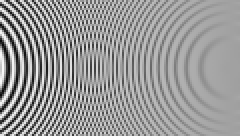
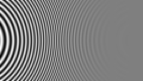
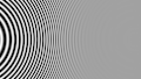
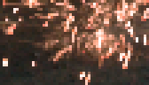
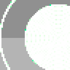
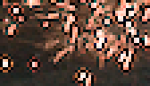
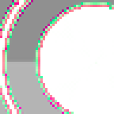
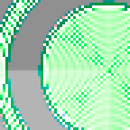
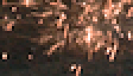
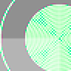

# Downscaling

<details open markdown="block">
  <summary>
    Table of contents
  </summary>
  {: .text-delta }
1. TOC
{:toc}
</details>

This page is about shrinking images and video, for example from a 4K plate to a 1920×1080 review file. Enlarging is
not covered.

**For SDR images and video, shrink in linear light; FFmpeg's `zscale` and `oiiotool` give the same result. For
scene-linear material such as ACES OpenEXRs, the usual choice is lanczos in a log space (the camera's own log for
plates, ACEScct for CG), which gives up a little brightness to avoid halos around highlights.**

{: .note }
> There is no perfect answer for scene-linear material. In principle you should shrink in linear light, but every way
> of doing that has a visible side effect, so the usual choices knowingly bend the science. For SDR material,
> shrinking in linear light costs nothing but a longer filter chain.

## Why shrinking dims fine detail

Shrinking averages neighboring pixels. SDR code values are gamma-encoded, not proportional to light, so averaging
them gives the wrong brightness: a fine black-and-white pattern gives off half the light of white, which is code 188 in
sRGB, but averaging the codes gives 128. Every resize filter in FFmpeg and in `oiiotool` works on the values it is
given, so unless the image is converted to linear light first, fine detail comes out too dark.

The filter makes no difference to the brightness; only shrinking in linear light fixes it. It matters most for fine,
high-contrast detail: test charts, text, thin lines, hair and fabric, CG and graphics. On a zone plate FFmpeg's default
resize comes out 30 codes too dark; on an animation frame, which is mostly flat color, it is under one code.

<details markdown="block">
  <summary>Measurements: three sRGB images</summary>

We shrank three sRGB images to a quarter of their size and compared each with a reference that averages each 4×4 block
of pixels in linear light. The table gives the mean difference from the reference in 8-bit code values; the results
were the same on FFmpeg 6.1.6, 8.1 and 9.0.2, with `oiiotool` 3.1.

| Brightness vs the reference (0 is perfect, negative is too dark) | Zone plate | Test chart | Animation |
| :--- | ---: | ---: | ---: |
| `scale`, any filter | −30.7 | −5.7 | −0.5 |
| `zscale`, any filter | −30.2 | −5.3 | −0.2 |
| `oiiotool --resize` | −30.2 | −5.3 | −0.2 |
| `zscale`, lanczos, in linear light | 0.0 | +0.7 | −0.1 |
| `oiiotool`, lanczos3, in linear light | 0.0 | +0.7 | −0.1 |

</details>

Part of the zone plate (enlarged 2×). The coarse rings on the left come out the same in all three; to the right they
get finer until they average to gray, which is much darker after FFmpeg's default resize (the faint rings at the right
of the reference are aliasing from its simple 4×4 average). Click an image to compare it with the reference in the
[resize comparison](https://encode.taurich.org/tests/resize-compare/compare.html#src=zoneplate&a=source&b=scale_bicubic&mode=toggle&zoom=4&at=0.671,0.500) (click the image there, or press Space, to switch between them):

| Reference (averaged in linear light) | FFmpeg's default `scale`, on the sRGB values | `zscale` lanczos, in linear light |
| :---: | :---: | :---: |
| [](https://encode.taurich.org/tests/resize-compare/compare.html#src=zoneplate&a=source&b=scale_bicubic&mode=toggle&zoom=4&at=0.671,0.500) | [](https://encode.taurich.org/tests/resize-compare/compare.html#src=zoneplate&a=source&b=scale_bicubic&mode=toggle&zoom=4&at=0.671,0.500) | [](https://encode.taurich.org/tests/resize-compare/compare.html#src=zoneplate&a=source&b=zscale_lanczos_linear&mode=toggle&zoom=4&at=0.671,0.500) |

The source is sRGB-encoded (close to a gamma of 2.2); any gamma-encoded source behaves the same way.

## SDR: shrink in linear light

Convert to linear light, resize, and convert back. `zscale` does this inside FFmpeg, in the same filter chain as the
conversion to Y'CbCr (tested on FFmpeg 6.1.6 and 9.0.2):

```console
ffmpeg -framerate 24 -i input.%04d.png -c:v libx264 -pix_fmt yuv420p \
    -vf "zscale=primariesin=709:primaries=709:transferin=iec61966-2-1:transfer=linear,format=gbrpf32le,zscale=w=1920:h=1080:filter=lanczos,zscale=primariesin=709:primaries=709:transferin=linear:transfer=iec61966-2-1,zscale=matrix=709:range=limited:filter=lanczos,setparams=color_primaries=bt709:color_trc=iec61966-2-1" \
    -color_range tv -colorspace bt709 output.mp4
```

`oiiotool` gives practically the same pixels, if you would rather resize the frames before encoding:

```console
oiiotool --frames 1-200 input.%04d.png --colorconvert srgb_tx lin_rec709 --resize:filter=lanczos3 1920x1080 \
    --colorconvert lin_rec709 srgb_tx -d uint16 -o resized.%04d.png
```

Both assume an sRGB-encoded source; for another curve, change `transferin` and `transfer` (or the `oiiotool` color
spaces) to match. In the FFmpeg chain, the overshoot of the lanczos filter at bright edges survives into the headroom
above limited-range white rather than being clipped.

## Scene-linear OpenEXRs {#scene-linear-openexrs}

Shrink a scene-linear source, such as an ACES OpenEXR, before the view transform (the display rendering, such as the
ACES 2.0 SDR view). That averages the light in the scene, as a lower-resolution camera would see it; after the view
transform the highlights have already been tone mapped, so even a resize in display-linear light gets them wrong.

But scene-linear values have no upper limit, and sharp filters ring around highlights far above white. We tested two
ACES2065-1 OpenEXRs with extreme highlights: Netflix's Sparks (up to about 200 times scene white) and BrightRings from
the OpenEXR test images (fine rings up to 1025 on gray, made for testing filters). Each was shrunk by 4 and viewed
through OCIO's "ACES 2.0 - SDR 100 nits (Rec.709)" view, against a reference that averages each 4×4 block in
scene-linear light and then applies the view.

Crops of both, enlarged 3×. BrightRings' green disc is fine rings of a single very bright channel, which should
average to nearly white. Click an image to compare it with the reference in the
[EXR resize comparison](https://encode.taurich.org/tests/resize-hdr-compare/compare.html#src=sparks&a=source&b=hdr_oiio_scene_lanczos&mode=toggle&zoom=4&at=0.742,0.870):

| | Sparks | BrightRings |
| :--- | :---: | :---: |
| Reference | [](https://encode.taurich.org/tests/resize-hdr-compare/compare.html#src=sparks&a=source&b=hdr_oiio_scene_lanczos&mode=toggle&zoom=4&at=0.742,0.870) | [](https://encode.taurich.org/tests/resize-hdr-compare/compare.html#src=brightrings&a=source&b=hdr_oiio_scene_lanczos&mode=toggle&zoom=4&at=0.670,0.240) |
| Lanczos, scene-linear | [](https://encode.taurich.org/tests/resize-hdr-compare/compare.html#src=sparks&a=source&b=hdr_oiio_scene_lanczos&mode=toggle&zoom=4&at=0.742,0.870) | [](https://encode.taurich.org/tests/resize-hdr-compare/compare.html#src=brightrings&a=source&b=hdr_oiio_scene_lanczos&mode=toggle&zoom=4&at=0.670,0.240) |
| Lanczos, ACEScct | [](https://encode.taurich.org/tests/resize-hdr-compare/compare.html#src=sparks&a=source&b=hdr_oiio_acescct_lanczos&mode=toggle&zoom=4&at=0.742,0.870) | [](https://encode.taurich.org/tests/resize-hdr-compare/compare.html#src=brightrings&a=source&b=hdr_oiio_acescct_lanczos&mode=toggle&zoom=4&at=0.670,0.240) |
| Lanczos, `highlightcomp` | [](https://encode.taurich.org/tests/resize-hdr-compare/compare.html#src=sparks&a=source&b=hdr_oiio_scene_lanczos_hc&mode=toggle&zoom=4&at=0.742,0.870) | [](https://encode.taurich.org/tests/resize-hdr-compare/compare.html#src=brightrings&a=source&b=hdr_oiio_scene_lanczos_hc&mode=toggle&zoom=4&at=0.670,0.240) |

- Resizing after the view transform makes highlights and their surroundings too dark, whatever the filter.
- Lanczos's negative lobes leave dark halos around each highlight, the worst errors we measured. Clamping negative
  values to zero does not help (we tried): the halo is still darker than its surroundings.
- Highlight compensation (`oiiotool --resize:highlightcomp=1`) compresses each channel with a log curve above 0.18
  before filtering and expands the result afterwards. There are no halos, but the Sparks highlights keep only about
  56% of their light, the fine rings of BrightRings only about 9%.
- Lanczos in log (ACEScct) has no halos either, and is a little darker. BrightRings' colors lie outside the ACEScct
  gamut, and some of its pixels overflow to infinity (the white pixels in the disc), so it has no valid result in log
  (see [which log space](#which-log-space-and-which-lanczos)).
- The cubic with b = 0 and c = 0 (the Hermite cubic) has no negative lobes, so no halos, and measures closest to the
  reference. It is `oiiotool`'s `cubic`, `zscale`'s `filter=bicubic:param_a=0:param_b=0` and Nuke's default Reformat
  filter, Cubic; all three give the same pixels. Mitchell (b = c = 1/3) has small negative lobes, so it can still ring
  a little.

<details markdown="block">
  <summary>Measurements: Sparks and BrightRings</summary>

Values are 8-bit code values, measured with FFmpeg 9.0.2, `oiiotool` 3.1.12 and OCIO 2.5; FFmpeg (`zscale`, then the
`ocio` filter) gives the same results as `oiiotool` for the same filter. Brightness is the mean difference from the
reference (negative is too dark); largest errors is the difference that only 1% of pixels exceed (the 99th
percentile), so it shows halos that barely move the mean. Both are 0 for a perfect result.

| Resize (0 is perfect in every column) | Sparks: brightness | Sparks: largest errors | BrightRings: brightness | BrightRings: largest errors |
| :--- | ---: | ---: | ---: | ---: |
| After the view transform, on the display values (any filter) | −3.3 | 60–74 | −10.4 | 72–83 |
| After the view transform, in display-linear light (lanczos) | −2.5 | 51 | −8.9 | 65 |
| Scene-linear: lanczos | −1.5 | 105 | +0.8 | 144 |
| Scene-linear: lanczos with highlight compensation (`highlightcomp`) | −2.7 | 48 | −8.7 | 116 |
| Log (ACEScct): lanczos | −3.2 | 51 | no valid result | no valid result |
| Scene-linear: cubic with no negative lobes (b = c = 0) | +1.6 | 41 | +1.9 | 87 |

A factor that is not a whole number, such as 4096 to 1920 wide, behaves the same: lanczos still rings (Sparks −4.6,
139), and the cubic comes closest to the reference (+0.9, 18).

</details>

### Ordinary scenes

Those two images are extreme. On ordinary photographs with moderate highlights every method is within about a code of
the reference; log is the darkest, by about as much as resizing the display image, which is what most video
pipelines already do. Fine, high-contrast detail is where log costs most, at any brightness: a scene-linear zone plate
with no highlights at all comes out 11.5 codes too dark in ACEScct (7.6 shrinking by 2). Highlight compensation leaves
values below 0.18 alone, so it darkens less of the picture.

<details markdown="block">
  <summary>Measurements: ordinary scenes</summary>

Three OpenEXR test images with moderate highlights (Carrots, whose brightest value is 0.96; Cannon, 2.6; MtTamWest,
4.9) and a scene-linear zone plate with values only between 0.05 and 0.5, each shrunk by 4, measured with the
OpenImageIO 3.1.12 Python bindings and OCIO 2.5 (mean difference from the reference, in 8-bit code values):

| Brightness vs the reference (0 is perfect, negative is too dark) | Carrots | Cannon | MtTamWest | Zone plate, 0.05–0.5 |
| :--- | ---: | ---: | ---: | ---: |
| Scene-linear: lanczos | −0.2 | −0.3 | 0.0 | +0.1 |
| Scene-linear: cubic (b = c = 0) | +0.2 | +0.3 | +0.1 | +0.4 |
| Scene-linear: lanczos with highlight compensation | −0.3 | −0.9 | −0.1 | −7.0 |
| Log (ACEScct): lanczos | −0.9 | −1.1 | −0.6 | −11.5 |
| After the view transform, on the display values (lanczos) | −0.6 | −1.1 | −0.2 | −9.2 |

</details>

### Which to use

- **Lanczos in log, or with highlight compensation**, is the common choice in grading and compositing. It is sharp and
  has no halos. Fine detail and very bright highlights come out a little dark: under about a code on ordinary
  photographs, but several codes on fine, high-contrast detail, and a colorful highlight that should average to near
  white keeps its color. Which log, from the facilities we asked:
  - **Plates:** the camera's own log encoding and gamut, such as Log3G10/REDWideGamutRGB for RED or LogC4/ARRI Wide
    Gamut 4 for ARRI. Cameras can record colors outside AP1, the gamut of ACEScct, and those can leave artifacts when
    resized in ACEScct.
  - **CG:** ACEScct.
  - **ACES2065-1 plates from many cameras**, where tracking each camera's format is not practical: ACEScct in most
    cases; for extreme colors, a log with a very wide gamut, such as Log3G10/REDWideGamutRGB or LogC4/ARRI Wide
    Gamut 4.
  - Keep the log values in 32-bit float, with values above and below the curve's usual range intact.
  - For VFX plates, Nuke's Lanczos4 (`zscale`'s `filter=lanczos:param_a=2`; `oiiotool` has no equivalent), which rings
    a little less. Lanczos6 (`oiiotool`'s `lanczos3`, `zscale`'s default) is sharper, which some shots call for.
- **A cubic with no negative lobes, in scene-linear**, measures closest to the reference and has no halos, but it is
  softer and spreads a little of each very bright highlight into its neighbors (a slight bloom). We have not seen it
  recommended for this.
- **Lanczos in scene-linear** is accurate except around highlights far above white, where it leaves dark halos. It is
  fine for material without them.

<details markdown="block" id="which-log-space-and-which-lanczos">
  <summary>Details: log spaces, gamut, and Nuke's lanczos</summary>

**Nuke's names.** Nuke names lanczos by its full width, `oiiotool` and `zscale` by the number of lobes on each side.
Nuke's Lanczos6 is the usual 3-lobe lanczos, `oiiotool`'s `lanczos3` (which also accepts the name `nuke-lanczos6`) and
`zscale`'s default; Nuke's Lanczos4 has 2 lobes, `zscale`'s `filter=lanczos:param_a=2`. `oiiotool` only has the 3-lobe
version: changing its filter width stretches the same kernel. Against Nuke 17.1's Reformat on Sparks (in
scene-linear, then the view), 99.9% of pixels are within 1.2 code values for Lanczos4 and `param_a=2`, and within 0.5
for Lanczos6 and `lanczos3` (0.7 for `zscale`). A few pixels next to the brightest highlights differ by more, so the
match is close but not exact, as it is for the cubic.

**Why the gamut matters.** Below zero, these log curves are straight lines: ACEScct, Log3G10, LogC4 and the others
do not compress negative values. A color outside the log space's gamut has a negative channel, which can become a
very large negative log value, and lanczos's overshoot next to it can then overflow when converted back to linear.
BrightRings is the extreme case, rings of a single channel at up to 1025, outside every gamut we tried:

| | Lowest log value | Pixels with a negative channel | Output pixels that overflow to infinity |
| :--- | ---: | ---: | ---: |
| BrightRings, ACEScct | −2549 | 7.8% | 1670 (4.2%) |
| BrightRings, Log3G10/REDWideGamutRGB | −2097 | 7.8% | 1495 (3.7%) |
| BrightRings, LogC4/ARRI Wide Gamut 4 | −1718 | 6.3% | 1100 (2.8%) |
| Desk, ACEScct | −58 | 1.0% | 0 |
| Desk, Log3G10/REDWideGamutRGB | −37 | 0.2% | 0 |
| Desk, LogC4/ARRI Wide Gamut 4 | −27 | 0.3% | 0 |

How the overflowed pixels look depends on the software: white when OCIO applies the view directly from the log space,
black when they are converted back to linear first. So BrightRings has no meaningful result in any log space. Desk, a
photograph with a backlit stained-glass window (treated as ACES2065-1), has five times fewer negative pixels in the
wide camera gamuts than in ACEScct, and nothing overflows.

**Results.** Lanczos with 3 and 2 lobes, in scene-linear and in log, shrinking Sparks, Desk and the scene-linear
zone plate by 4 (brightness, largest errors, in 8-bit code values, as above):

| Resize (0 is perfect in every column) | Sparks: brightness | Sparks: largest | Desk: brightness | Desk: largest | Zone plate: brightness | Zone plate: largest |
| :--- | ---: | ---: | ---: | ---: | ---: | ---: |
| Scene-linear, Lanczos6 (`lanczos3`) | −1.5 | 105 | −2.3 | 103 | +0.1 | 18 |
| Scene-linear, Lanczos4 | −1.4 | 81 | −1.5 | 59 | +0.3 | 13 |
| ACEScct, Lanczos6 | −3.1 | 51 | −3.6 | 60 | −11.3 | 24 |
| ACEScct, Lanczos4 | −3.2 | 55 | −3.4 | 54 | −11.3 | 22 |
| Log3G10/REDWideGamutRGB, Lanczos6 | −2.9 | 49 | −3.3 | 52 | −10.2 | 23 |
| Log3G10/REDWideGamutRGB, Lanczos4 | −2.9 | 52 | −3.1 | 47 | −10.2 | 21 |
| LogC4/ARRI Wide Gamut 4, Lanczos6 | −2.8 | 48 | −3.3 | 52 | −9.5 | 22 |
| Scene-linear, Lanczos6 with `highlightcomp` | −2.7 | 48 | −3.1 | 50 | −6.8 | 19 |

- The camera logs are slightly better than ACEScct, by a few tenths of a code value in brightness and a few on the
  largest errors. LogC3, S-Log3 and DaVinci Intermediate fall between ACEScct and these two. Every log darkens fine
  detail by about the same amount (the zone plate).
- Lanczos4 rings less than Lanczos6: much less in scene-linear, a little less in log. A 4-lobe lanczos (Nuke's
  Lanczos8) rings more.
- `highlightcomp` depends on the gamut too, since its curve is applied to each channel. It makes no difference on
  Sparks or the zone plate, under 0.3 of a code on Desk, and on BrightRings brightness ranges from −6.9 in
  REDWideGamutRGB to −8.9 in ACEScg.

Measured with FFmpeg 9.0.2 and 8.1 (`zscale`), `oiiotool` 3.1.12 and OCIO's built-in studio config, which has the
camera log spaces, by
[`tests/resize-logspaces.py`](https://github.com/AcademySoftwareFoundation/EncodingGuidelines/blob/main/tests/resize-logspaces.py).

</details>

There are ways to keep lanczos's sharpness without its halos, such as anti-ringing, but none is a single option in
FFmpeg or `oiiotool` yet; see
[sharp filters without halos](tests/resize-hdr-compare/resize-hdr.html#sharp-filters-without-halos) on the EXR test
page.

### Commands

With `oiiotool`, lanczos in ACEScct, or with highlight compensation:

```console
oiiotool --frames 1-200 input.%04d.exr --colorconvert ACES2065-1 ACEScct --resize:filter=lanczos3 1920x1080 \
    --ociodisplay:from=ACEScct "sRGB - Display" "ACES 2.0 - SDR 100 nits (Rec.709)" -d uint16 -o resized.%04d.png

oiiotool --frames 1-200 input.%04d.exr --resize:filter=lanczos3:highlightcomp=1 1920x1080 \
    --ociodisplay:from=ACES2065-1 "sRGB - Display" "ACES 2.0 - SDR 100 nits (Rec.709)" -d uint16 -o resized.%04d.png
```

With FFmpeg 8.1 or later built with the `ocio` filter (see [FFmpeg OCIO Filter](FfmpegOcio.html)), the conversion
to ACEScct, the resize, the view transform and the conversion to Y'CbCr go in one command; it gives the same pixels as
the `oiiotool` command above (FFmpeg 9.0.2). `OCIO=ocio://default` selects OCIO's built-in config, so use your own
config as usual:

```console
OCIO=ocio://default ffmpeg -framerate 24 -i input.%04d.exr -c:v libx264 -pix_fmt yuv420p \
    -vf "ocio=input=ACES2065-1:output=ACEScct:format=gbrpf32le,format=gbrpf32le,zscale=w=1920:h=1080:filter=lanczos,format=gbrpf32le,ocio=input=ACEScct:display=sRGB - Display:view=ACES 2.0 - SDR 100 nits (Rec.709):format=rgb48,format=rgb48le,zscale=matrix=709:range=limited:filter=lanczos,setparams=color_primaries=bt709:color_trc=iec61966-2-1" \
    -color_range tv -colorspace bt709 output.mp4
```

For Nuke's Lanczos4, add `:param_a=2` to the resize; `oiiotool` has no 2-lobe lanczos. To resize in a camera log, put
its name in place of ACEScct in both `ocio` filters, with a config that has it: OCIO's `ocio://default` (its CG
config) has ACEScct but no camera logs, while `ocio://studio-config-latest` has them. For
example, Log3G10/REDWideGamutRGB with Lanczos4 (FFmpeg 9.0.2; the same pixels as `tests/resize-logspaces.py` measures):

```console
OCIO=ocio://studio-config-latest ffmpeg -framerate 24 -i input.%04d.exr -c:v libx264 -pix_fmt yuv420p \
    -vf "ocio=input=ACES2065-1:output=Log3G10 REDWideGamutRGB:format=gbrpf32le,format=gbrpf32le,zscale=w=1920:h=1080:filter=lanczos:param_a=2,format=gbrpf32le,ocio=input=Log3G10 REDWideGamutRGB:display=sRGB - Display:view=ACES 2.0 - SDR 100 nits (Rec.709):format=rgb48,format=rgb48le,zscale=matrix=709:range=limited:filter=lanczos,setparams=color_primaries=bt709:color_trc=iec61966-2-1" \
    -color_range tv -colorspace bt709 output.mp4
```

For highlight compensation, use OIIO's curve as a CLF file
([`tests/rangecompress.clf`](https://github.com/AcademySoftwareFoundation/EncodingGuidelines/blob/main/tests/rangecompress.clf)):
`ocio=filetransform=rangecompress.clf` in place of the conversion to ACEScct, the same with `:inverse=1` after
`zscale`, and the view from ACES2065-1 (see
`hdr_ff_ocio_hc_ocio` in
[`tests/resize-test.py`](https://github.com/AcademySoftwareFoundation/EncodingGuidelines/blob/main/tests/resize-test.py)).

{: .warning }
> Put `zscale` straight after the input. FFmpeg 8.0 and later decode half-float EXRs as half-float; `zscale` resizes
> those directly, but a `format=gbrpf32le` in front of it makes FFmpeg convert them with libswscale, which clamps
> every value to 0–1 and loses the highlights before the resize (on the Sparks frame, the brightest value falls from
> about 227 to 1.16). See [FFmpeg Version Changes](FFmpegChanges.html#exr-half-float-80).

### Background

Ringing around HDR highlights is an old problem, and the usual remedies all trade sharpness, energy or color:

- [Cinematic Color](https://www.imageworks.com/sites/default/files/2023-10/Cinematic-Color-imageworks-library-cinematic_color_0.pdf#page=37)
  (Jeremy Selan, SIGGRAPH 2012 course notes), page 37, gives three remedies: roll off the highlights, filter and
  unroll (which does not preserve highlight energy); a simple camera flare model; and filtering in log, which grossly
  distorts energy and suits only operations close to 1:1, such as lens distortion.
- Practitioners recommend resizing in log to stop lanczos ringing, for example in this
  [Logik forum thread](https://forum.logik.tv/t/anamorphic/5089) for Autodesk Flame users.
- OpenImageIO's [`oiiotool --resize:highlightcomp=1`](https://openimageio.readthedocs.io/en/latest/oiiotool.html) and
  [`maketx --hicomp`](https://openimageio.readthedocs.io/en/latest/maketx.html) are the roll-off approach; the
  `maketx` documentation notes that it can lose some energy, which is often preferable to ringing.
- Real-time rendering uses the same trick before averaging bright samples: Brian Karis's
  [tone mapping before averaging](https://graphicrants.blogspot.com/2013/12/tone-mapping.html) and Timothy Lottes's
  [reversible tonemapper for MSAA resolve](https://gpuopen.com/learn/optimized-reversible-tonemapper-for-resolve/).
- ImageMagick's examples compare
  [resizing in different color spaces](https://usage.imagemagick.org/resize/#resize_colorspace): linear light
  exaggerates dark halos, perceptual spaces exaggerate light ones, and a
  [sigmoidal color space](https://usage.imagemagick.org/resize/#resize_sigmoidal) reduces both.
- FFmpeg's [`libplacebo` filter](https://ffmpeg.org/ffmpeg-filters.html#libplacebo) has an `antiringing` strength. It
  runs on the GPU through Vulkan; we have not tested it on HDR sources.

## Choosing a filter

The filter controls sharpness and artifacts, whichever space you resize in. For live action the consensus is
typically lanczos. Sharp filters can ring, leaving light and dark halos along hard edges, which is often given as a
reason to use a softer filter for animation and motion graphics. When shrinking SDR material the ringing is subtle: on
our animation frame, 99% of pixels are within 5 code values of the area filter, which cannot ring (see them in the
[resize comparison](https://encode.taurich.org/tests/resize-compare/compare.html#src=animation&a=scale_area&b=scale_lanczos&mode=toggle&zoom=4&at=0.279,0.196)). It
matters far more for scene-linear highlights, above. Compare the results on your own material.

| Filter | `scale` | `zscale` | `oiiotool` | Character |
| :--- | :--- | :--- | :--- | :--- |
| Lanczos, 3 lobes | `flags=lanczos` | `filter=lanczos` | `lanczos3` (its default for shrinking) | Sharp; can ring at hard edges. Nuke's Lanczos6 |
| Lanczos, 2 lobes | `flags=lanczos:param0=2` | `filter=lanczos:param_a=2` | | A little softer, rings less. Nuke's Lanczos4 |
| Spline | `flags=spline` | `filter=spline36` | | Sharp and smooth |
| Bicubic | `flags=bicubic` (the default) | `filter=bicubic` | `catmull-rom`, `mitchell` | In between |
| Cubic, b = c = 0 | | `filter=bicubic:param_a=0:param_b=0` | `cubic` | A little soft; no negative lobes, so no ringing, even around HDR highlights |
| Bilinear | `flags=bilinear` | `filter=bilinear` (the default) | `triangle` | Soft |
| Area / box | `flags=area` | | `box` | Softest, no ringing |
| Nearest | `flags=neighbor` | `filter=point` | | No filtering: fine detail aliases badly. Not for resizing |

- [Comparison gallery of image scaling algorithms - Wikipedia](https://en.wikipedia.org/wiki/Comparison_gallery_of_image_scaling_algorithms)
- [Cambridge in Color - resizing for web and email](https://www.cambridgeincolour.com/tutorials/image-resize-for-web.htm)
- [ImageMagick Examples -- Resampling Filters](https://www.imagemagick.org/Usage/filter)
