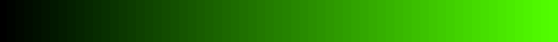
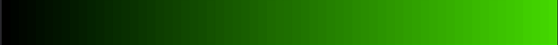
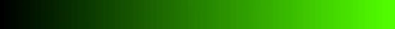

# ORI Video Encoding Guidelines

This project is from the [ASWF Open Review Initiative](https://openreviewinitiative.org/). It attempts to establish best practices for encoding Video media for VFX/Animation media review. We aim to explain what various parameters do, and in what situations you might want to choose to modify them.

This is not the site for general encoding, although you may find answers here, we will likely opt for a simple one-size fits all solution over file-size efficiency.
We welcome suggestions and improvements.

{: .highlight }
We recommend [VP9](EncodeVP9.html) and [AV1](EncodeAv1.html) over H.264 and HEVC/H.265 where your review tools and browsers support them, to encourage the use of patent-free codecs; see the white-paper [Next-gen codecs for VFX Community](https://docs.google.com/document/d/1EJ7Q_HhjL0ELNdjz5AgnPrraUvy7XCo52LL08WxgjtA/edit#heading=h.9rkn78tjmq48). The [Encoding Cheatsheet](Quickstart.html) still starts with H.264, because it plays almost everywhere.

## What changed in late 2026

{: .important }
> **We now recommend `zscale` rather than `scale` for the RGB to Y'CbCr conversion.** Earlier versions of these
> guidelines recommended FFmpeg's `scale` filter (libswscale). More careful measurement, against an independent
> reference rather than by comparing the filters with each other, showed that libswscale puts white slightly too
> high (943 instead of 940 at 10-bit) for 10-bit and higher sources, and centres the chroma in 4:2:2 and 4:2:0
> where co-sited chroma is expected. We are sorry this was not caught earlier. The error is small in a single
> pass, but it is systematic, and it builds up when files are re-encoded. See
> [RGB to Y'CbCr Conversion](ColorPreservation.html) and [FFmpeg swscale Filter](EncodeSwsScale.html).

libswscale is being rewritten, and its new code (`scale=...:flags=unstable`, FFmpeg 8.1 and later) already gets
the white level right for 4:4:4. We are tracking each FFmpeg release with a test suite, and once the new code has
settled down we hope to bring the recommendation back to the built-in `scale` filter, which every FFmpeg build has.

Also new:

* [FFmpeg Version Changes](FFmpegChanges.html): FFmpeg 7.1 changed what the color flags do, and other changes up to
  9.1 that alter the output of existing command lines, measured on each version.
* [FFmpeg zscale Filter](EncodeZscale.html): the options, tags and pitfalls of `zscale`.
* [Chroma Siting](ChromaSiting.html): where 4:2:2 and 4:2:0 chroma should sit, and which tools get it right.
* [Downscaling](Resizing.html): shrinking in linear light, and the choices for scene-linear EXRs.
* [Preparing Frames with oiiotool](OiiotoolConversion.html): the color management before FFmpeg, and tagging the
  frames it writes.

## Why is this needed

There are a lot of excellent guides out there. But few addressing the needs of the VFX community.

An example of why this is important is to compare:

<table>
<TR><TD style='padding-top:0px; padding-bottom: 0px' >Original PNG Image</TD><TD style='padding-top:0px; padding-bottom: 0px'></TD><TD style='padding-top:0px; padding-bottom: 0px'></td></TR>
<TR><TD style='padding-top:0px; padding-bottom: 0px'>Default FFmpeg conversion (before FFmpeg 7.1)</TD><TD style='padding-top:0px; padding-bottom: 0px'> </td><td style='padding-top:0px; padding-bottom: 0px'> NOTE color shift compared to original</TD></TR>
<TR><TD style='padding-top:0px; padding-bottom: 0px'>Converting explicitly to BT.709 with zscale</TD><TD style='padding-top:0px; padding-bottom: 0px'> </td><td style='padding-top:0px; padding-bottom: 0px'> Should match original</TD></TR>
</table>

You can see the default FFmpeg conversion introduces a dramatic color shift, but with the right flags you can match the original. See [RGB to Y'CbCr Conversion](ColorPreservation.html) for more details on this.

## Where to start

* **Need a command now?** The [Encoding Cheatsheet](Quickstart.html) has tested H.264 and ProRes commands, with an
  explanation of each flag.
* **Building or fixing a pipeline?** [Encoding Overview](EncodingOverview.html) walks through the steps from EXRs to
  a tagged movie, with a link to the detail for each step.
* **Choosing a codec?** [Codec Comparisons](Encoding.html) starts with which codec to use for which job.
* **A command behaves differently after an FFmpeg upgrade?** See [FFmpeg Version Changes](FFmpegChanges.html).

## Common pitfalls

These are the problems we see most often, each with the page that explains it:

* **FFmpeg converts with the wrong matrix by default.** Before FFmpeg 7.1, untagged RGB images are converted with
  BT.601, the shift shown above. See [RGB to Y'CbCr Conversion](ColorPreservation.html).
* **The `scale` filter (libswscale) gets 10-bit and higher white wrong**, putting it at 943 instead of 940, and
  centres the chroma. We recommend `zscale`; see [FFmpeg zscale Filter](EncodeZscale.html).
* **The color flags changed meaning in FFmpeg 7.1.** `-color_primaries` and `-color_trc` are now ignored, and
  `-colorspace` converts the pixels rather than just tagging them. See [FFmpeg Version Changes](FFmpegChanges.html).
* **Browsers ignore or misread some color tags**, so the same file can look different in Chrome, Safari and RV. See
  [Color Metadata and Web Color Preservation](WebColorPreservation.html).
* **Chroma siting is easy to get wrong in 4:2:2 and 4:2:0**, and the error grows each time a file is re-encoded. See
  [Chroma Siting](ChromaSiting.html).
* **Shrinking display-referred (gamma-encoded) images changes the brightness of fine detail.** See
  [Downscaling](Resizing.html).

The full list of pages is in the navigation on the left. The test framework behind the measurements is described in
[ORI Encoding Test Framework](enctests/README.html), and its results are in [Test Output](Testresults.html).

### Acknowledgements  

This document is a result of feedback from many people, in particular I would like to thank Kevin Wheatley, Trevor Aylward, Mark Reid, Gates Roberg Clark, Rick Sayre, Wendy Heffner and J Schulte for their time and patience.  

### Status

This document and project is still a work in progress. We are working on building a more complete testing framework, so that it is easy to confirm that changes to ffmpeg are not breaking existing functionality.

### Authors

This document is primarily the work of Sam Richards with input from the ASWF community. The test suite was developed by Daniel Flehner Heen.

### Feedback and error reporting

We welcome feedback on this document, please report any errors or suggestions to the [github issues](https://github.com/AcademySoftwareFoundation/EncodingGuidelines/issues) page.

The original Confluence page for this work is [Movie Compression with ffmpeg for media review](https://lf-aswf.atlassian.net/wiki/spaces/PRWG/pages/11274685/Movie+Compression+with+ffmpeg+for+media+review).
