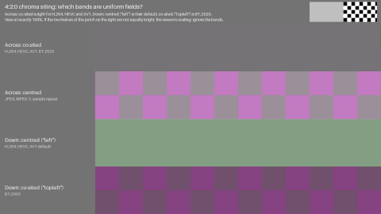
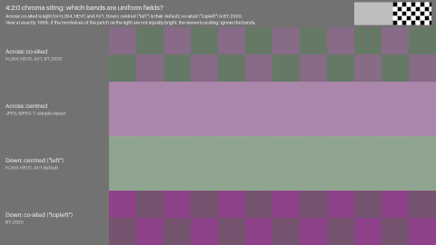

# Chroma Siting Check: Does the Player Follow the Label?

  

    Table of contents
  

  {: .text-delta }
1. TOC
{:toc}

**[Open the viewer page](view.html)** to go through the files in a browser.

Each file is made for its own chroma siting label. A player that follows the label shows a flat field; any other
player shows the word **WRONG**. So the rule is the same for every file: blank is right.

The [viewer page](view.html) shows each file at exactly one video pixel per screen pixel, records your answers, and
gives a summary to copy. In other players, open the files at 100%. For what a wrong player is doing instead (which
filter, not just which position), use the [4:2:2 player chart](../../ChromaSitingPlayerChart.html); to see single
pixels, the [pixel charts](../../ChromaSitingPixelChart.html).

## The files

A 4:2:0 file has two panels, Across and Down, which can be wrong independently; a 4:2:2 file has only Across. The
HEVC files are 10-bit and the H.264 files 8-bit, so that browsers play them. The FFV1 (`.mkv`) and MXF files are
for desktop players.

| File | Label | Should be |
| :--- | :--- | :--- |
| [420-hevc-untagged.mp4](chroma_siting_check_420-hevc-untagged.mp4), [420-h264-untagged.mp4](chroma_siting_check_420-h264-untagged.mp4) | None | Across co-sited, Down centered (`left`, the default) |
| [420-hevc-left.mp4](chroma_siting_check_420-hevc-left.mp4), [420-lossless-left.mkv](chroma_siting_check_420-lossless-left.mkv) | `left` | Across co-sited, Down centered |
| [420-hevc-topleft.mp4](chroma_siting_check_420-hevc-topleft.mp4), [420-h264-topleft.mp4](chroma_siting_check_420-h264-topleft.mp4), [420-lossless-topleft.mkv](chroma_siting_check_420-lossless-topleft.mkv) | `topleft` | Co-sited both ways |
| [420-hevc-center.mp4](chroma_siting_check_420-hevc-center.mp4), [420-h264-center.mp4](chroma_siting_check_420-h264-center.mp4), [420-lossless-center.mkv](chroma_siting_check_420-lossless-center.mkv) | `center` | Centered both ways |
| [422-prores-untagged.mov](chroma_siting_check_422-prores-untagged.mov), [422-hevc-untagged.mp4](chroma_siting_check_422-hevc-untagged.mp4), [422-dnxhr-untagged.mxf](chroma_siting_check_422-dnxhr-untagged.mxf) | None (MXF `ColorSiting` 0) | Co-sited |
| [422-lossless-left.mkv](chroma_siting_check_422-lossless-left.mkv) | `left` | Co-sited |
| [422-lossless-center.mkv](chroma_siting_check_422-lossless-center.mkv), [422-dnxhr-center.mxf](chroma_siting_check_422-dnxhr-center.mxf) | `center` (MXF `ColorSiting` 1) | Centered |

Every name starts with `chroma_siting_check_`. The files are 640 pixels wide and 360 high (216 for 4:2:2), and the
whole set is under 2 MB. They are made by [make_chroma_siting_check.py](../make_chroma_siting_check.py), and
[tests/chroma_siting_check.py](../../tests/chroma_siting_check.py) measures them as FFmpeg decodes them, or from a
1:1 screenshot (`--capture`). Do not re-encode them: compression blurs the one-pixel stripes.

### HDR10 {#hdr10}

HDR video often takes a different path through a player (tone mapping, macOS EDR, a TV's HDR mode), and HDR10 is
where the specifications disagree most (see [What specifications ask for](../../ChromaSiting.html#what-specifications-ask-for)).
These are HEVC Main 10, BT.2020, PQ, with mastering display and content light level metadata; only the chroma
location in the VUI differs:

| File | VUI chroma location | Should be |
| :--- | :--- | :--- |
| [420-hevc-pq-untagged.mp4](chroma_siting_check_420-hevc-pq-untagged.mp4) | None (so `left`) | Across co-sited, Down centered |
| [420-hevc-pq-left.mp4](chroma_siting_check_420-hevc-pq-left.mp4) | 0 (`left`), written explicitly | Across co-sited, Down centered |
| [420-hevc-pq-topleft.mp4](chroma_siting_check_420-hevc-pq-topleft.mp4) | 2 (`topleft`), as Ultra HD Blu-ray, ATSC 3.0 and DVB BT.2020 use | Co-sited both ways |

Every pixel is between 1 and 100 cd/m2 (MaxCLL 100) and inside the BT.709 gamut, so no display tone maps
or gamut maps it, and a screenshot does not clip it.

### Rotated copies

Phone video is often stored sideways with a display matrix that turns it upright. The label describes the stored
frame, so a player has to rebuild the chroma on the stored frame's grid and then rotate, or swap the siting if it
rotates the Y'CbCr planes first. These copies are stored turned 90 degrees and say to turn them back:

* [420-hevc-left-rot90.mp4](chroma_siting_check_420-hevc-left-rot90.mp4)
* [420-hevc-topleft-rot90.mp4](chroma_siting_check_420-hevc-topleft-rot90.mp4)
* [420-h264-untagged-rot90.mp4](chroma_siting_check_420-h264-untagged-rot90.mp4)
* [420-h264-topleft-rot90.mp4](chroma_siting_check_420-h264-topleft-rot90.mp4)
* [422-hevc-untagged-rot90.mp4](chroma_siting_check_422-hevc-untagged-rot90.mp4)
* [422-prores-untagged-rot90.mov](chroma_siting_check_422-prores-untagged-rot90.mov)

Their Across panel on screen tests the stored frame's vertical siting, so a rotated 4:2:2 file has a Down panel
instead. Each should be blank, as for the file it was made from.

## Viewing them

* **Exactly 100%, from a distance.** A viewer that scales the picture averages the code values first, and the word
  disappears whatever the player does. The scale check at the top right shows it: its two halves look equally
  bright from a distance only at 100%.
* **The display mode must be 1:1 with the panel.** A macOS "looks like" mode that is not the panel's native
  resolution or exactly half of it rescales everything, so every file looks right. The viewer page warns when the
  OS is sending a width no panel has (6400 for a 4K screen at "looks like 3200x1800").
* **Large pixels need more distance.** On a screen with about 110 pixels per inch, such as a 27" 2560x1440, the
  stripes and the word's outline are easy to see close up. Stand back further than for a Retina screen.
* **Browsers draw video in more than one way**: handed to the operating system, or composited into the page.
  Clicking, pausing, or showing controls can switch between them. The viewer page has switches for controls and
  nearest-neighbor rendering, and a link to open the file on its own, to compare. A result that changes with these
  is a real difference between the browser's drawing paths, not a fault in the file.
* **HDR10 needs an HDR display in its HDR mode**, with the whole window on it: on a Mac, a window on (or partly on)
  an SDR screen is tone mapped to SDR. On a TV, turn off dynamic tone mapping, sharpening and noise reduction, and
  use a mode with no picture processing (Filmmaker or Cinema mode).

## How it works

A panel's background repeats a four-pixel cycle of stripes, vertical for Across and horizontal for Down, and the
word has the same chroma with the luma of the mirror image. If the mirror passes through a chroma sample, any player
that treats the samples as co-sited, with any symmetric filter, rebuilds the word as the exact mirror image of the
background: the two contain the same pixels and the word disappears. A player that thinks the samples are centered
pairs luma and chroma differently in the two, and the word shows. Mirrored between two pixels instead, it is the
other way round. Each panel uses the mirror that matches the label.

So the right answer is exact whatever the filter, the display's gamma, or a view transform. The colors were chosen
so that a wrong player differs by at least 0.065 in Oklab (linear light), or 0.071 for HDR10, with every pixel in
gamut; [`chroma_siting_420_colours.py`](../chroma_siting_420_colours.py) checks them. Where the word's edge crosses
the stripes, the pattern changes phase, which would show as an outline, so the edge is staggered by 0 to 7 pixels
from row to row. Close up the word is still faintly visible as a change of texture: judge it from a distance.

## Results

### Players

These are what the players did with the full HD [4:2:0 chart](#the-full-hd-420-chart) and the
[4:2:2 player chart](../../ChromaSitingPlayerChart.html), restated as what the check files should show. They are
not yet measured with the check files themselves. Measured on macOS 26 (Apple M2) from window screenshots at 1:1.

4:2:0, SDR. **WRONG** across means the color is half a pixel to the right; down, half a line too high or too low:

| Player | HEVC `left` | HEVC `topleft` | HEVC `center` | H.264 untagged | H.264 `topleft` | H.264 `center` |
| :--- | :--- | :--- | :--- | :--- | :--- | :--- |
| Safari 26.6.2 | Blank | Blank | Blank | Blank | **WRONG** both | Blank |
| Chrome 156 | Blank | Blank | Blank | Blank | **WRONG** both | Blank |
| Firefox 152 | Blank | **WRONG** down | **WRONG** across | Blank | **WRONG** down | **WRONG** across |
| OpenRV 3.1.0 | **WRONG** across | **WRONG** both | Blank | **WRONG** across | **WRONG** both | Blank |
| xStudio, with the 4:2:2 fix | Blank | **WRONG** down | **WRONG** across | **WRONG** across | **WRONG** both | not tested |

The H.264 files are 8-bit. Chrome showed 10-bit H.264 centered across (it gets 8-bit right), and xStudio 8-bit HEVC
centered across: there it is the bit depth, not the codec, that matters.

HDR10 (macOS 26.6.2, built-in XDR display at its native 3024x1964, no other displays; OpenRV and xStudio do not
display HDR), and 4:2:2:

| Player | HDR10 untagged, `left` | HDR10 `topleft` | 4:2:2 HEVC | 4:2:2 ProRes |
| :--- | :--- | :--- | :--- | :--- |
| Safari 26.6.2 | Down **faint** | Blank | Blank | Nearly blank, stripes close up |
| Chrome 157 (4:2:2: 156) | Down **faint** | Blank | Blank | Does not play |
| Firefox 159 (4:2:2: 152) | Blank | **WRONG** down | Vertical chroma also lost | Does not play |
| QuickTime Player 10.5 | Down **faint** | Blank | not tested | not tested |
| OpenRV 3.1.0 | — | — | **WRONG** | **WRONG** |
| xStudio, with the 4:2:2 fix | — | — | Blank | Blank |

"Faint": Safari, Chrome and QuickTime Player place untagged and `left` HDR10 chroma between the two vertical
positions, or blur it vertically; on the chart both down bands kept a checkerboard at a quarter to a third of the
contrast of a wrong band. They follow a `topleft` tag exactly. The same SDR files were right, so the cause is
probably the macOS HDR video path the three share (not confirmed). Safari's ProRes takes each odd column's chroma
from the nearest sample, and rounding decides which, so it is close to right over an area but every odd pixel is
wrong. The rotated files have not been tried in any player yet.

If you go through the files, the summary from the viewer page is welcome as an issue on the repository.

### FFmpeg

Measured with `python tests/chroma_siting_check.py` on 9.1. 9.0.2 is the same, except that planar RGB treats every
file as centered both ways.

| Conversion | Files not rotated | Rotated files |
| :--- | :--- | :--- |
| `zscale` | Blank, except **WRONG** for the MXF with `ColorSiting` 1 (FFmpeg does not read it) | **WRONG** |
| No filter, to planar RGB | Blank, except **WRONG** for the untagged 4:2:2 files (no label FFmpeg reads, so it assumes centered) | **WRONG** |
| No filter, to packed RGB | **WRONG** across for everything but `center`, and down too for 8-bit `topleft` | **WRONG** |

FFmpeg gets every rotated file wrong. Its autorotate inserts `transpose` on the Y'CbCr planes, and `transpose` does
not change the chroma location, so the conversion to RGB that follows puts the chroma in the wrong place, with
`zscale` as well as libswscale (measured on 9.0.2 and 9.1; `libavfilter/vf_transpose.c` is unchanged on the master
branch). Decoding with `-noautorotate`, converting with `zscale` and rotating the RGB gives a blank field. Any tool
built on FFmpeg that rotates the same way has the same problem.

## The full HD 4:2:0 chart

The player results above came from an earlier, full HD chart that uses the same mirror trick. Instead of one answer
per label it has four bands, and the bands that turn into flat fields say what the player assumes:

| Band | Flat when the player treats the chroma as | Right for |
| :--- | :--- | :--- |
| Across: co-sited | co-sited across | H.264, HEVC, AV1 and BT.2020 4:2:0 |
| Across: centered | centered across (also sample repeat) | JPEG, MPEG-1 |
| Down: centered ("left") | centered down | H.264, HEVC and AV1 by default (FFmpeg's `left`) |
| Down: co-sited ("topleft") | co-sited down | BT.2020, and files tagged `topleft` |

| `zscale`: across co-sited, down centered | libswscale on 9.0: centered both ways |
| :--- | :--- |
|  |  |

It is useful when a result is neither one thing nor the other, as with the HDR10 files above. The files are in
`sourceimages/`, made by [make_chroma_siting_player_chart_420.py](../make_chroma_siting_player_chart_420.py) and
measured by `tests/chroma_siting_player_chart.py --420`:

* SDR: [chroma_siting_player_chart_420-hevc.mp4](../chroma_siting_player_chart_420-hevc.mp4) (HEVC Main 10, `left`),
  [-h264.mp4](../chroma_siting_player_chart_420-h264.mp4) (8-bit, untagged),
  [-h264-10bit.mp4](../chroma_siting_player_chart_420-h264-10bit.mp4),
  [-hevc-8bit.mp4](../chroma_siting_player_chart_420-hevc-8bit.mp4), and copies tagged `topleft` and `center`
  ([-hevc-topleft.mp4](../chroma_siting_player_chart_420-hevc-topleft.mp4),
  [-hevc-center.mp4](../chroma_siting_player_chart_420-hevc-center.mp4),
  [-h264-topleft.mp4](../chroma_siting_player_chart_420-h264-topleft.mp4),
  [-h264-center.mp4](../chroma_siting_player_chart_420-h264-center.mp4),
  [-h264-10bit-topleft.mp4](../chroma_siting_player_chart_420-h264-10bit-topleft.mp4),
  [-h264-10bit-center.mp4](../chroma_siting_player_chart_420-h264-10bit-center.mp4)), with a lossless copy in
  [-lossless.mkv](../chroma_siting_player_chart_420-lossless.mkv).
* HDR10: [-hevc-pq.mp4](../chroma_siting_player_chart_420-hevc-pq.mp4) (untagged),
  [-hevc-pq-left.mp4](../chroma_siting_player_chart_420-hevc-pq-left.mp4),
  [-hevc-pq-topleft.mp4](../chroma_siting_player_chart_420-hevc-pq-topleft.mp4), with a lossless copy in
  [-pq-lossless.mkv](../chroma_siting_player_chart_420-pq-lossless.mkv). At 1920x1080 these need a display mode at
  the panel's native resolution, without HiDPI, to be shown at 100% on a laptop screen.
